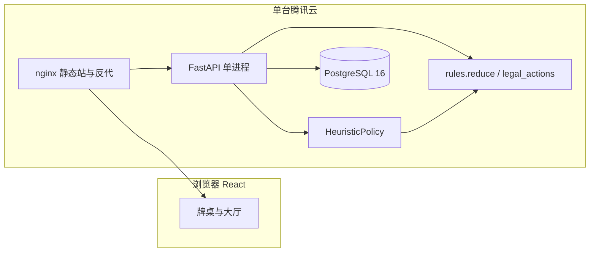
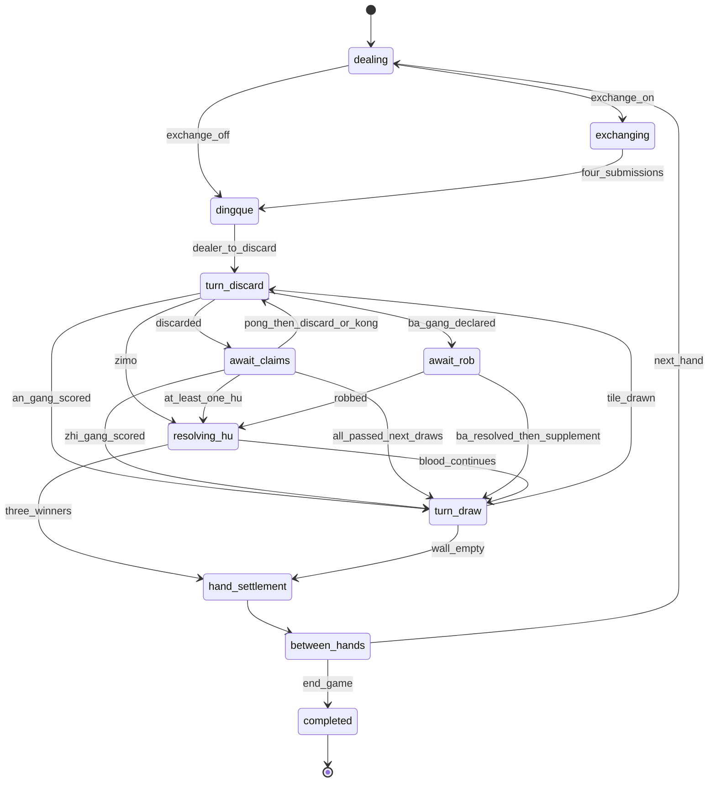

# 四川麻将训练网页游戏技术设计

| 项 | 值 |
| --- | --- |
| 文档标题 | 四川麻将训练网页游戏（成都血战到底）技术设计 |
| 作者 | design-doc-writer |
| 日期 | 2026-10-14 |
| 状态 | Draft |
| 产品代号 | cmahjong |
| 规则版本 | `chengdu-xz-1` |
| 仓库 | `/home/solitern/CMahjong`（绿地，当前无代码、无依赖、无既有架构） |

本文是实现规格，不是宣传稿。文中的 Python / TypeScript 片段是接口与伪代码，不是要提交的实现。目标读者是将直接按本文写代码和测试的工程师。

---

## Overview

本产品是单人四川麻将训练工具：1 名人类 + 3 个服务端人机，玩法锁定为成都血战到底，规则版本字符串 `chengdu-xz-1`。没有匹配、房间邀请或实时对战。训练价值完全取决于规则引擎：番型、谁付钱、刮风下雨、呼叫转移、查花猪、查大叫、退税，任何一条算错都会让复盘失去意义。

系统采用「浏览器只渲染、服务端权威判定」。人类在牌桌提交动作后，FastAPI 在同一请求内用纯函数规则引擎推进状态，并用人机 `Policy` 连续代打，直到再次轮到人类、或本盘进入结算。权威状态、事件日志和账本写入 PostgreSQL。刷新页面从快照继续；命名存档冻结决策点，加载时不重掷已经做过的人机决定。第一期人机是确定性启发式，能合法打完整盘；更强 AI 与对局指导只留接口，不进第一期。

预期负载：1 个主要用户，偶尔几个账号，同时进行中的对局 < 10。动作 API 在同机（含启发式人机、不含前端动画）目标 < 100 ms。单盘事件通常 < 300 条，快照 < 100 KB。

---

## Background & Motivation

仓库 `/home/solitern/CMahjong` 为空，没有可复用的服务、数据库或前端。市面上的四川麻将分属多套互不兼容的番表：联众成都血战、欢乐/微乐、以及各地房规，在自摸是否加番、点杠花谁包赔、过手胡能否因加番而破、龙七对是否单列、封顶几番上都不一致。若把这些平台写进同一套不可配置的 `if`，测试无法判定对错。

用户要的是部署在自己腾讯云上的私人训练器，而不是多人产品：能注册登录，对局随时可续，能命名多槽存档，界面能看懂每一笔番与条款。第一期先保证一整盘血战在规则上是对的；AI 教练、复盘播放器、血流成河都明确后置。因此本文把规则规格写成一等公民，并把「哪一条相对联众公开页做了收紧或保留」写在规格里，而不是留到实现时再猜。

---

## Goals & Non-Goals

### Goals（Phase 1）

- 锁定并实现可测试的 `chengdu-xz-1`：换三张、定缺、血战到底、一炮多响、刮风下雨、呼叫转移、查花猪、查大叫、退税。
- 服务端权威、纯函数、可复现。给定 `(state, action)` 得到新状态；人机与人类走同一套 `legal_actions`。
- 每一笔分数是账本分录。结算界面和以后的复盘只读账本，不在 UI 里重算。
- 账号密码登录；HttpOnly cookie 会话；用户只能读写自己的对局和存档。
- 每步自动保存；命名存档可多局并存；加载恢复到精确决策点。
- 启发式人机打完一盘且动作合法。能胡则胡，不是随机出牌。
- 结算展示番型明细和条款 id。大厅有与引擎一致的规则说明页。
- 单机 Docker Compose 部署到腾讯云轻量或 CVM。

### Non-Goals（本阶段不做）

- 多人对战、匹配、房间邀请、观战、排行榜、好友、商城、支付。
- 血流成河，以及任何第二套番表的运行时配置器。
- 模型推理、提示词、AI 教练、出牌推荐。听牌提示不出现在 v1 响应里（字段预留，恒为 `null`）。
- 复盘播放器的 UI（事件字段在 v1 定义完整，播放器属 Phase 2）。
- 手机竖屏验收、Kubernetes、Redis、微服务、第三方登录。
- 客户端第二套规则引擎。前端不得自行判断「这口能不能胡」。

---

## 规则规格

### 1. 版本、出处与故意偏离

规则版本字符串：`chengdu-xz-1`。它持久化在每一局 `games.ruleset_version`。以后只要番种、倍率、谁付钱或过水语义发生变化，必须新增版本（例如 `chengdu-xz-2`），旧档只走旧版本代码路径，禁止就地改写事件。

v1 只注册这一个版本。`enable_exchange`、`enable_jingoudiao`、`base_score` 是该版本内部的开关/参数，写入 `games.rules`，不另起版本号。它们的默认值：

| 字段 | 类型 | 默认 | 说明 |
| --- | --- | --- | --- |
| `base_score` | int，闭区间 1–10000 | `1` | 只乘和牌分与查叫分、花猪极品。不乘刮风下雨。小于 1 或大于 10000 的创建请求是 422，不写入 `games.rules` |
| `fan_cap` | int | `5` | v1 固定 5，创建对局时不可改 |
| `enable_exchange` | bool | `true` | 换三张 |
| `enable_jingoudiao` | bool | `false` | 金钩钓附加番 |
| `show_ting_hint` | bool | `false` | v1 引擎可内部计算，但响应永远不带提示 |

权威来源（2026-10-14 核对）：

1. 联众《血战到底麻将（成都）》：<https://www.ourgame.com/game/game-intro-new/h2g/sichuanmj_002.html> ，以及同文旧页 <https://www.ourgame.com/game/game-intro/SiChuanmj.html>。
2. 百度百科「四川麻将」「血战到底」「四川血战麻将」。百科内部本身有地区分叉，只用来标出分叉，不单独当番表。
3. 不采用、也不混入：欢乐、微乐、DoubleWin 一类「自摸 +1、番型互相叠加、清一色 2 番」的表；波克《血战麻将》<http://mm.pook.com/xzmj/rule/rule-3.html> 的番数（清一色 3 番但龙七对列在 5 番、封顶口径不同）只作反例。

联众成都公开番表与本版本的关系：

| 条目 | 联众成都公开页 | `chengdu-xz-1` | 理由 |
| --- | --- | --- | --- |
| 牌型番与封顶 | 素番 1、对对和 2、清一色 3、暗七对 3、全带幺 3、清带幺/清对/清七对/将对 4；加番累加后最多极品 5；分 = 底 × 2^(番−1) | 采用，名称改用川麻通行说法（平胡、全幺九、清幺九） | 与联众表一致 |
| 自摸 | 不加番；自摸未胡者各付一份；点炮只点炮者付，不包三家 | 采用 | 这是成都口径，不是欢乐「自摸 +1」 |
| 刮风下雨 | 暗杠每家 2；直杠点杠者 2；巴杠每家 1 | 采用，且不乘 `base_score` | 联众「假定基本分为 1」时杠分是固定分 |
| 呼叫转移 | 杠上炮把本次杠分转给和牌者；一炮多响每家一份，放炮者另赔 | 采用 | 见第 8 节数字例子与零和说明 |
| 查卫生 | 花猪赔给所有非花猪（含已和）极品，不再另赔查叫；未听按最大番赔听牌者；未听者杠分无效 | 采用 | 与联众、百科「查卫生」一致 |
| 龙七对 | 公开番表**没有**这一行。七对带四张在联众口径是暗七对 3 + 根 | **单列牌型番 4**，第一组四张不再加根 | 数值在「非清一色七对」上与联众等价（3+1=4）。单列是为了结算界面能教这个名字。清一色七对带四张的并列规则见第 6 节，避免把根吞掉 |
| 海底捞月 | 公开加番列表只有根、抢杠、杠上炮、杠上花、天和、地和，**无海底** | **保留 +1** | 编排规格明确要求。这是相对联众公开页的房规追加，写死在本版本，不做成开关 |
| 过水 | 「未摸下一张之前不能弃先和后，但**有加番可以和**；牌墙不足时可以和」 | **加番不破过水** | 故意收紧，更好教。牌墙不足由「最后四张必胡」覆盖，不靠过水例外 |
| 最后四张 | 原文括号：「牌张数与未和牌人数相同」 | **固定牌墙剩余 ≤ 4** | 故意不随未胡人数缩小。血战中后段比联众更早进入必胡 |
| 杠上花谁付钱 | 「杠某家打出的牌而杠上开花，为引杠者输点」；普通自摸才三家付 | **一切杠上花都按自摸，未胡者各付一份** | 编排规格明确要求。不实现「点杠花包一家」。暗杠、直杠、巴杠之后的杠上花同一待遇 |
| 地胡 | 「闲家摸第一张牌即和牌」；部分资料把「胡庄家打出的第一张」也叫地胡 | **仅闲家自己的第一次摸牌自摸**，且此前全场没有任何碰、杠。胡庄家第一张弃牌**不是**地胡 | 按编排规格。该口若成立，只是普通点炮 |
| 死叫 | 百科写明有的地区算叫、有的不算 | **死叫不算下叫** | 按编排规格 |
| 暗杠展示 | 成都页写「必须亮出」；联众另一血战页写「只亮一张，其余看不见」 | **四张全部面朝上**，副露种类仍是暗杠 | 训练和复盘要看见张子。展示不改变结算：下雨 2 分，且不可抢杠 |
| 金钩钓 | 成都公开表没有 | 开关，默认关。开启时按形状附加 +1，不与计分牌型集合求交 | 避免把民间番悄悄混进默认表。两门全幺九的碰碰胡单钓也加，见第 6.4 节 |
| 换三张 | 该介绍页的核心条文未把换三张列为胜负条款 | **默认开启**，可关 | 现代成都局的常规训练项。关闭时跳过该阶段，规则版本不变 |
| 及时雨（过手杠） | 本次核对到的联众成都公开页**没有**这句 | **采用** | 巴杠只有第四张是本回合刚摸到或刚补到的，才写 `kong.gua_feng_ba`。延迟宣告、以及能直杠却先碰再巴杠，都不收杠分，和牌时只算根。碰后、弃牌前允许暗杠和巴杠。暗杠仍收下雨。见第 4 节与例子 E |

除上表已点名的偏离外，不另加番、不另改支付。及时雨改的是「延迟巴杠收不收刮风」，已经写在表里，不是实现时的自由裁量。

### 2. 牌、座位、牌墙

- 只用万、条、筒，点数 1–9，每张 4 枚，共 108 张。无风、无箭、无花。
- 4 人。不能吃。动作枚举里不存在吃。
- 座位 `0..3`。行牌逆时针：下家 = `(seat + 1) % 4`。人类固定 seat 0，画面在下方。庄家可以是任意座位。固定人类座位只影响 UI，不影响规则。
- 称呼：0 东、1 南、2 西、3 北。东的下家是南。
- 起手：庄家 14 张，闲家 13 张。发牌后牌墙剩余 108 − 53 = 55 张。
- 牌张有稳定 id `0..107`：`suit_index = id // 36`（0 万、1 条、2 筒），`rank = (id % 36) // 4 + 1`，`copy = id % 4`。所有手牌、牌墙、事件都用 id，不用「一张五万」这种不可区分的值。
- 洗牌：对局主种子 `seed` 为 32 字节，CSPRNG 生成。每一盘的子种子为 `HMAC-SHA256(seed, "hand:{hand_index}")`。用该子种子驱动 Fisher–Yates。生产回放**不依赖**再次洗牌：发牌事件的服务端 payload 写入完整牌墙顺序。回放以事件为准。种子用于测试复现，以及核对「同一种子得到同一牌墙」。
- Python 版本固定 3.12 镜像，避免 `random.Random` 跨大版本漂移。即便如此，回放仍以事件里的牌墙为准。
- 摸牌与杠后补牌都是牌墙序列的下一张。不模拟牌尾。牌墙为空则不能再杠，也不能再摸。
- 物理牌墙的方位在本产品中无意义，不展示。

### 3. 开局流程

每一盘：

1. **发牌**。确定庄家。第一盘庄家 = 子种子映射到 `0..3` 的均匀取值，写入事件。之后的庄家见第 7 节。
2. **换三张**（`enable_exchange=true` 时）。
   - 交换方向在任何人选择之前就确定并公开：`to_next`（换给下家，i → i+1）、`to_prev`（换给上家，i → i+3）、`to_across`（换给对家，i → i+2）。三选一，由本盘子种子决定。
   - 每人交出 3 张**同一花色**的牌。张数不足 3 的花色不能选。13 或 14 张、三种花色时，至少一门有 ≥ 5 张，因此总是存在合法选择。
   - 四人同时选择，互不可见。进入阶段时 `pending.decisions` 先放入全部四个必填座位，值都是 `None`。`reduce` 只把该座位的选择写进已有的键，不调用 `Policy`。编排器在进入本阶段的**同一数据库事务**里，只对值仍为 `None` 的人机座位调用一次 `Policy`。不在字典里不算「尚未提交」；创建之后不应再出现缺席。已写入的非 `None` 选择，加载存档不得重算。人类提交后若四个键都非 `None`，同一次 `reduce` 末尾才交换。
   - 交换后每人张数不变。庄家仍是 14。
3. **定缺**。每人在 `wan` / `tiao` / `tong` 中选一门。同时提交，互不可见，全部提交后同时亮出。本盘不可更改。定缺的 `pending` 与换三张同一谓词：四个座位先写入 `None`，编排器只填仍为 `None` 的人机，`reduce` 不调用 `Policy`。
4. 进入出牌。庄家不再摸牌，先打出第一张。若庄家手上有缺门，第一张必须是缺门。

`enable_exchange=false` 时跳过步骤 2，直接定缺。

天胡的判定点在换三张和定缺**都完成之后**、庄家打出任何牌之前。见第 6.4 节。

### 4. 行牌硬约束

记「手上有缺」= 暗手中仍有定缺花色的牌。副露里出现缺门是非法状态，reducer 不得产生。

- 手上有缺时，合法出牌只能是缺门牌。
- 手上有缺时，不能碰、杠、胡（含抢杠、自摸）。
- 不能碰、杠定缺的那一门。弃牌若是自己的缺门，不能碰、不能直杠、不能胡。
- 胡牌时，手牌（含副露、含和进的那张）最多两种花色。缺门牌不能进入和牌牌型。
- 不能吃。
- 动作优先级：**胡 > 杠 > 碰 > 过**。
- 同一张弃牌多人可胡：**一炮多响**。所有选择胡的未胡玩家都胡，不截胡。
- 碰与直杠争同一张弃牌：直杠优先，碰失败。四张牌里只有一家可能持有三张，因此直杠至多一家。两家都只有对子时可以同时具备碰的资格：碰的优先座位是出牌者的下家起、逆时针第一家。
- 已胡玩家退出行动：不摸、不打、不应牌、不付此后的杠分和点炮/自摸。花猪赔付除外（已胡的非花猪仍收花猪的极品）。
- 三家胡：立即结束本盘，不让剩下那一家再摸牌。然后做第 6.8 节的结算（花猪与退税仍可能发生；没有第二个未胡者，所以没有查大叫的收付对手）。
- 牌墙耗尽且仍有人未胡：在当前这张弃牌的应牌窗口处理完之后，下一位未胡玩家需要摸牌但牌墙为空，进入结算。

**过水（过手胡）**

- 置位条件看结果，不看按钮名字：该座位在这次弃牌窗口或抢杠窗口里**当时能胡**，并且这次结算里他**没有胡成**，则置 `pass_hu[seat]=true`。包括：显式过；选择碰或杠；选择了碰或杠但被更高优先级的胡抢走，碰/杠没有生效。
- 合法动作里根本没有胡的过，不置位。
- 抢杠窗口 `await_rob` 使用同一条，不是另一套过水。
- 标记为真时，在他下一次从牌墙摸牌（含杠后补牌）之前，不能胡任何弃牌，也不能抢杠。即使另一张牌、即使番数更高，也不行。
- 自摸（含杠上花、海底、天胡、地胡）不受过水限制。放弃自摸**不会**置过水标记。
- 摸牌（含补牌）后清除该座位的过水标记。
- 加番不破过水。这是相对联众的收紧。
- **最后四张必胡优先于过水。** `legal_actions` 的生成顺序是：先判断必胡，再套过水。必胡且能胡时，列表只有 `hu`，即使 `pass_hu` 为真也不删掉胡、也不提供过。必胡窗口不会新进入过水，因为玩家无法弃胡。

**最后四张必胡**

- 统一口径：这张牌被拿到手或被打出**之前**，牌墙剩余张数 `<= 4`。
- 自摸和补牌用**摸之前**的剩余。摸完再看 `<= 4` 会把倒数第五张也算进必胡，禁止。摸之前还剩 5 张时，自摸后仍可弃牌；摸之前还剩 4、3、2、1 张时，能胡则只能胡。
- 弃牌用弃牌当时的剩余（牌已经不在墙上）：当时 `<= 4` 则能胡的玩家只能胡。
- 抢杠不是摸牌，也不是弃牌。打开 `await_rob` 时按**宣告当时**的 `wall_remaining <= 4` 重写状态位 `must_hu`，禁止沿用杠者摸牌时留下的布尔。摸之前剩 5、摸完剩 4 时自摸可以弃牌，但此刻宣告巴杠，能抢的人必须胡。摸之前剩 6、摸完剩 5 时，抢杠仍可过。
- 从而不能故意放过这张牌，躲进查叫。
- 海底捞月仍是摸牌**之后** `wall_remaining == 0` 的自摸。摸之前剩余 1 张，既是海底，也落在必胡里。两者不要混成同一个比较式。

**牌张只活在一处**

108 个 id 的守恒按 id 集合，不把各家亮牌列表拼起来再数。

- 点炮、一炮多响：和牌张留在牌河，这条弃牌带 `claimed_by`（胡它的座位元组）。各家 `WinPublic.tile` **引用**同一个 id，不复制进多家暗手或亮牌。亮牌列表本身不含这个引用。
- 自摸：id 只在胡牌者亮开的手牌里，不在牌墙、也不在牌河，也不再单独挂一份「和牌张」。
- 抢杠见下面的 `pending_ba_kong`。被抢后，该 id 写成杠者牌河上的一条弃牌并带 `claimed_by`，碰保持为碰。

**杠**

- 暗杠：暗手四张相同。自己的出牌回合、弃牌之前可以开，**包括碰完之后、被迫弃牌之前**。不可抢。立即下雨结分，然后补牌。
- 直杠：暗手刻子，他人打出第四张，在应牌窗口杠。不可抢。杠优先于碰。立即刮风结分，然后由杠者补牌。能直杠却改碰**不会**因为「放弃了杠」而置过水。只有这次窗口里同时能胡、并且没有胡成，才按过水节置 `pass_hu`。不能胡的改碰不置位，下一张弃牌在摸牌前仍然可以胡。这一张之后再巴杠是否收分，只看 `tile_id == drawn_this_turn`；碰之后该字段已空，所以不是及时雨，不必另加标记。
- 巴杠：已有碰，暗手持有第四张。自己的出牌回合、弃牌之前可以宣告，同样**包括碰完之后、被迫弃牌之前**。宣告时先进入 `await_rob`，**先不改副露、先不记杠分**。第四张 id 放进 `pending_ba_kong = {seat, tile_id}`，从暗手移出，不在可弃牌里，也不在碰的三张里。这是可存档的决策点。
  - 及时雨只看这一条：`tile_id == drawn_this_turn`（本回合刚摸到或刚补到的那一张）才在无人抢之后写 `kong.gua_feng_ba`。不看玩家有没有放弃过直杠。
  - 无人抢且及时：碰升级为巴杠，id 进入该副露，记刮风，然后补牌。
  - 无人抢但不及时（延迟巴杠，或先碰后杠）：碰仍升级为巴杠，id 进入副露，**不写杠分分录**（`gross=0`），然后补牌。和牌时这组四张只算根。条款记在事件上：`rule.jishiyu`。
  - 有人抢：清除 `pending_ba_kong`，碰保持为碰，不计杠分，不补牌。写 `kong.qianggang_cancel`。该 id 进入杠者牌河并标 `claimed_by`。按点炮胡，附加抢杠番。多人可抢则一炮多响，仍是**一条**和牌事件。
- 牌墙剩余 0 张时，三种杠都非法（没有补牌）。
- 暗杠展示：四张 id 全部进入公开副露，`kind="an_kong"`。UI 四张面朝上，并标「暗杠」。

**回合内的杠标记**

`after_kong[seat]` 只覆盖「这次杠的补牌」以及「紧接着的那一张弃牌」。弃牌的应牌窗口一旦关闭就清掉，不能留到下一轮。

- 暗杠、直杠，或及时巴杠未被抢：在补牌之前置 `after_kong[seat]=true`，`last_kong_receipt_id` 指向刚写入的 `KongReceipt`。不及时的巴杠未被抢：**不产生收据**（没有杠分），`last_kong_receipt_id` 置空，但 `after_kong` 仍为真，因为仍然补牌。
- 补牌本身不清 `after_kong`。补牌后自摸：杠上花。延迟巴杠同样可以杠上花；没有收据就不写呼叫转移。
- 补牌后若再杠：新的一笔收据替换 `last_kong_receipt_id`，`after_kong` 保持 true。连续杠的杠上花仍只 +1。
- 补牌后打出的那一张若被胡：杠上炮。呼叫转移只针对 `last_kong_receipt_id`。该字段为空时不写 `pay.hujiao_zhuanyi`。
- 这张弃牌的窗口关闭时（有人胡、有人碰、有人直杠，或全部过），**清除弃牌者**的 `after_kong`。清的不是新杠者。新的直杠者另起自己的 `after_kong` 和收据。
- 此后弃牌者再摸进一张并自摸，只算普通自摸，`fan` 不含 `gangshanghua`。再打出一张被点炮，呼叫转移笔数为 0。
- 过水的清除在摸牌时，与 `after_kong` 无关。

**已胡之后的行动顺序**

- 点炮（含一炮多响、抢杠、杠上炮）：和牌张按上一小节留在牌河（抢杠则先落入杠者牌河）。下一动作为供牌者的下家起第一个未胡座位去摸牌。若已有三家胡，改为结算。
- 自摸（含杠上花、海底、天胡、地胡）：下一动作是胡牌者的下家起第一个未胡座位去摸牌。天胡时庄家还没有弃牌，下一动作同样是庄家下家摸牌。三家胡则直接结算。

**应牌窗口的执行方式**

窗口包括换三张、定缺、弃牌应牌、抢杠。`reduce` 在这些阶段**只记录**该座位的动作，不在中途把某一家先结算掉。

```text
pending = {
  kind: "exchange" | "dingque" | "claims" | "rob",
  decisions: {seat: Action | None},   # 创建后必填座位都在；None 表示尚未提交。缺席是非法状态
  source_seat: int | None,            # 弃牌者或巴杠者
  tile_id: int | None,
}
```

必填座位在创建 `pending` 时一次定死：换三张和定缺是四家；弃牌应牌是除弃牌者以外的未胡玩家；抢杠是除巴杠者以外的未胡玩家。已胡玩家和供牌者本人不在字典里。

- 进入窗口的那次 `reduce` 先把每个必填座位放进 `decisions`，值是 `None`，再把「合法动作只有过」或根本不能应的座位覆盖成 `pass`。不调用 `Policy`。打开 `await_rob` 的同一次 `reduce` 还要按宣告当时的 `wall_remaining <= 4` 重写 `must_hu`，然后再算这些合法动作，这样必胡的人不会被自动写成过。
- 编排器（API 层，不是 `reduce`）在同一事务里，只对值仍为 `None` 的人机座位调用一次 `Policy`，再 `reduce` 把决定写上。不扫描「不在字典里的座位」。已不是 `None` 的座位，加载后不得重算。
- 测试 `pending_none_before_resolve`：一张弃牌南、西两家 AI 和人类都能胡。返回人类之前，两家 AI 的决定已非 `None`，人类仍是 `None`，事件日志里还没有 `hu`。
- 人类座位仍是 `None` 且他有胡/杠/碰/换三张/定缺要选：事务提交当前快照（人机决定已经在里面），响应返回，等待人类。
- 某一座位的提交使所有必填座位都非 `None` 时，**同一次** `reduce` 末尾按优先级结算：胡（全体，一条 `hu` 事件）> 直杠 > 碰 > 过。不是谁先写入谁赢。
- 人类已胡、后面只剩人机时，这次请求可以一直编排到 `between_hands`。上限：256 步或 1500 ms，先到为准。触顶则提交已经一致的状态，`PlayerView.orchestration_paused=true`。客户端用新的 `seq` 自动提交 `{type:"continue"}`，编排器接着跑。`continue` 不是规则动作，不进 `legal_actions`。人类不需要点它。

### 5. 和牌牌型

只认两种骨架。

**标准型**：4 个面子 + 1 将。面子是顺子、刻子或杠。顺子只能自己摸成，不能吃。杠算一个面子。和牌张计入暗手后再分解。

**七对**：暗手 14 张、没有任何碰杠、恰好 7 个对子。四张相同未杠出计为两个对子，并触发龙七对（第 6 节）。

分解算法：标准型用回溯拆解（牌张规模很小，不必上表）。有副露则只走标准型，七对不成立。

**无副露时两种骨架都算**，不是「先拆标准型、拆得出就不再看七对」。各自算出 `fan_raw`（含根和金钩钓，不含过程番）。`fan_raw` 较大者胜；相等才让七对骨架优先（暗七对 / 龙七对 / 清七对）。封顶只发生在 `score_of` 里，不参与选骨架。因此两边封顶后都是 16 分时，仍然比未封顶的 `fan_raw`，不是比分。听牌和查大叫用同一套比较。标准型内部多种拆法，仍取该骨架下 `fan_raw` 最大的一种。

和牌额外条件：花色 ≤ 2，且不含自己的缺门。不满足则不是和牌，即使形状像。

固定夹具：清一色、无副露的 `11223344556677` 万。七对路径是清七对 4 番、无根，`fan_raw=4`，`score_of(4)=8`。标准型 `123 123 456 456 77` 只是清一色 3 番、4 分。`fan_raw` 更大的是七对。见例子 G。

再一个夹具：清一色、无副露的 `11112222333344` 万。七对骨架是清七对 4 加 3 根（三组四张都不被龙七对吞掉，因为清七对同为最高牌型），`fan_raw=7`。标准型 `123+111+222+333+44` 是清一色 3 加 3 根，`fan_raw=6`。两边 `score_of` 都是 16，但选骨架只比 `fan_raw`，所以取七对：`fan_raw=7`，`fan_charged=5`，分为 16。用例 `qidui_wins_when_both_capped`。这不是四家结算，不改例子 A–F。

### 6. 番与计分

#### 6.1 公式

```python
def score_of(fan: int, base_score: int, fan_cap: int = 5) -> int:
    if fan < 1:
        raise RuleError("chengdu-xz-1 has no 0-fan win")
    capped = min(fan, fan_cap)
    return base_score * (1 << (capped - 1))
```

因此默认底分 1 时：1 番 = 1，2 番 = 2，3 番 = 4，4 番 = 8，5 番及以上 = 16（极品）。最低和牌是平胡 1 番。没有 0 番。

分数是整数。账本金额恒为正，方向用 `from_seat → to_seat` 表示。

#### 6.2 牌型番：取最高，不叠加

| id | 名称 | 番 | 判定 |
| --- | --- | --- | --- |
| `pinghu` | 平胡 | 1 | 合法标准型，且不满足下表任何更高牌型 |
| `duidui` | 对对胡 | 2 | 标准型，4 个面子都是刻或杠，无顺子 |
| `qingyise` | 清一色 | 3 | 手牌与副露全部同一花色 |
| `anqidui` | 暗七对 | 3 | 七对，且没有任何一个点数出现 4 张 |
| `quanyaojiu` | 全幺九 | 3 | **只判定标准型**。每个面子和将都含 1 或 9。顺子只能是 123 或 789。将必须是 1 或 9。刻/杠必须是 1 或 9。七对不走这条 |
| `qingyaojiu` | 清幺九 | 4 | 清一色且全幺九。不另加清一色、全幺九 |
| `qingdui` | 清对 | 4 | 清一色且对对胡。不另加 |
| `jiangdui` | 将对 | 4 | 对对胡，且每张牌点数 ∈ {2,5,8}。不另加对对胡 |
| `qingqidui` | 清七对 | 4 | 清一色七对。不另加清一色、暗七对。可以带四张（根另算，见下） |
| `longqidui` | 龙七对 | 4 | 七对且至少一组四张相同。这是牌型番 |

牌型番算法：

```text
matched = 所有成立的牌型
top = max(fan)
top_set = {p in matched | p.fan == top}
charged_patterns = top_set
root_absorb = false
if charged_patterns == {longqidui}:
    root_absorb = true          # 只有龙七对独占最高档时，才吞掉第一组根
# 若清七对与龙七对同为 4 番同时成立：保留清七对，不把 longqidui 当作计分牌型
# 这样第一组四张仍然按根 +1。清七对的 4 番买的是花色，没有买掉四张。
if "longqidui" in charged_patterns and len(charged_patterns) > 1:
    charged_patterns = charged_patterns - {longqidui}
    root_absorb = false
pattern_fan = top               # 并列只收一次，不把 4+4 收成 8
```

展示：`charged_patterns` 里的每个 id 都写进账本明细。将对同时又是清对时，明细同时有 `qingdui` 与 `jiangdui`，番数仍是 4，不是 8。测试必须锁住这一点。

全幺九的「面子」用语意味着它不修饰七对。全是 1、9 的七对：按暗七对 / 龙七对 / 清七对计，**不加**全幺九或清幺九。

#### 6.3 根（可测试定义）

设和牌后的多重集合 = 暗手（含和进的那张）∪ 每个副露中的牌。按 `(suit, rank)` 分组，张数为 4 的组称为一个四张组，组数为 `root_count`。

- 暗杠、直杠、巴杠各是一个四张组，各算 1 根的候选。四张在副露里，不得在暗手里再计一次。
- 未杠出的四归一也算：和进的那张若使某点数变成 4，计入 `root_count`。标准型里这 4 张的拆法可以是「3 张作刻、1 张落在顺子里」。
- 附加根番 = `root_count - 1`（若 `root_absorb`）否则 `root_count`。下限 0。
- 因此：龙七对恰好一组四张 → 牌型 4，根附加 0，合计 4。两组四张 → 4 + 1 = 5。
- 禁止的算法：先取暗七对 3，再把龙七对那一组也 +1，再**另外**加一次龙七对。那会重复。
- 同样禁止：清七对带一组四张却套用 `root_count - 1`，从而少 1 番。

过程番不在根里。

#### 6.4 附加番

加在牌型番和根之上，然后封顶 5。

| id | 名称 | 番 | 何时 |
| --- | --- | --- | --- |
| `gen` | 根 | +1 / 有效根 | 第 6.3 节 |
| `gangshanghua` | 杠上花 | +1 | `after_kong` 且自摸。连续杠仍只 +1 |
| `gangshangpao` | 杠上炮 | +1 | `after_kong` 的那张弃牌被胡 |
| `qianggang` | 抢杠 | +1 | 抢巴杠成功。不再同时计杠上炮 |
| `haidi` | 海底捞月 | +1 | 摸牌后 `wall_remaining==0` 的自摸。不含「打出牌墙最后一张被点炮」 |
| `tianhu` | 天胡 | +4 | 庄家在换三张、定缺之后，打出任何牌之前，14 张已是合法和牌。视为自摸。手上若仍含缺门则不可能和牌，天胡不成立，必须先打缺 |
| `dihu` | 地胡 | +4 | 闲家在**自己第一次摸牌**时自摸，且此摸牌之前全场没有任何碰、杠（含暗杠）。不是「胡庄家打出的第一张」 |
| `jingoudiao` | 金钩钓 | +1 | 仅当 `enable_jingoudiao`。只看形状：和牌后暗手是将的两张，其余面子全是刻或杠。不与 `charged_patterns` 求交。因此两门 1/9 的四副碰加一对将，计分牌型可以只剩 `quanyaojiu`，仍然 +1 |

明确不计：

- 自摸不加番。自摸只改变付款人数。
- 不计门清。
- 不计断幺九、金钩钓（默认）、中张。
- 没有听用，不计无听用。
- 没有庄闲分差。

`fan_raw = pattern_fan + 附加番之和`，`fan_charged = min(fan_raw, 5)`，`points = score_of(fan_raw, base_score)`。账本同时记下 `fan_raw` 与 `fan_charged`，让界面能显示「6 番，按极品 5 番计 16 分」。

#### 6.5 谁付钱

只向当时还未胡的玩家结算。已胡玩家不付。

- 自摸，含杠上花、海底、天胡、地胡：每一位当时未胡的其他玩家各付一份 `points`。不因「这张杠是别人点的」改成一家包赔。
- 点炮，含杠上炮、抢杠：只有点炮者付一份 `points`。不包三家。
- 一炮多响：点炮者按每位胡牌者各付一份，份与份之间番数各自计算，可以不同。

#### 6.6 刮风下雨（即时，不乘底分，不乘番）

发生当时、抢杠窗口确认「未被抢」之后立刻下账。已胡玩家不付不收。

| 条款 id | 事件 | 支付 |
| --- | --- | --- |
| `kong.xia_yu` | 下雨（暗杠） | 每位当时未胡的其他玩家付 **2** |
| `kong.gua_feng_zhi` | 刮风直杠 | 点杠者付 **2** |
| `kong.gua_feng_ba` | 刮风巴杠 | 每位当时未胡的其他玩家付 **1**。仅及时雨：第四张是本回合摸到或补到的 |

这些 2 和 1 不乘 `base_score`。底分只用于和牌、查叫、花猪。不及时的巴杠不产生本行，见例子 E。暗杠不看及时雨。

#### 6.7 呼叫转移

杠上炮成立时，针对弃牌窗口关闭前仍挂在弃牌者身上的那笔 `KongReceipt`：

- 有 `last_kong_receipt_id` 时，`gross` 取该收据（暗杠通常是 2 × 当时未胡他家数，直杠是 2，及时巴杠是 1 × 当时未胡他家数）。没有收据（不及时巴杠）则视为没有可转移的杠分。
- 原支付者不再付第二次。
- 每一位胡这张杠上炮的玩家，都从杠者处再获得 `gross` 分。条款 id `pay.hujiao_zhuanyi`。
- 响数 `n=1`：杠者把实收原额转出，净杠分为 0。
- 响数 `n≥2`：杠者本笔借记 `n * gross`，大于实收。多出来的部分由杠者自己付，不是原支付者付，也不是系统铸造。

零和：四人金额变化之和**仍然是 0**。被打破的不变量不是零和，而是「转移总额 = 实收」。编排说明里的「非零和例外」按下面的测试期望理解，禁止实现成只给胡牌者加分、不从杠者扣减。

```text
assert sum(deltas_of_this_batch) == 0
if n >= 2:
    assert debited(kong_player) == n * gross
    assert debited(kong_player) > gross
```

抢杠成功的那一笔杠没有入账，不发生呼叫转移。不及时巴杠没有收据，杠上炮可以有 `gangshangpao` 番，但不写转移分录，也不触发「借记 > 实收」。窗口关闭时：若有收据，把 `transferred` 写成实际转出额；无论有没有收据，都清除弃牌者的 `after_kong`。同一收据不能再转第二次。

#### 6.8 流局与血战结束时的结算

触发：牌墙摸完仍有至少一家未胡；或三家已胡。先结束行牌，再按下面顺序**新写**账本分录。不删除已经写下的杠分分录。

可见牌，用于死叫（对某位被检查的未胡玩家 P）。先按 **tile id 去重**，再按 `(suit, rank)` 计数。不要把 `WinPublic.tile` 再加一遍。

- P 的暗手与 P 的副露；
- 所有座位的副露（暗杠在本产品中四张都公开，计入）；
- 所有牌河。点炮张和抢杠后落入牌河的那张只在这里出现一次；
- 已胡玩家亮开的手牌。点炮胡的亮牌**不含**那张引用 id。自摸张只在这份亮牌里，不另算一份和牌张；
- **不**包括其他未胡玩家的暗手，也**不**包括尚未摸的牌墙。

一张候选胡张是死的，当且仅当该点数在去重后的可见集合里已经有 4 个 id。否则是活的。点炮张若是该点数的第 3 个可见 id，该点数仍是活张；再把 `WinPublic.tile` 加进去会变成 4，测试 `live_wait_third_copy` 必须失败在那种算法上。

向听和进张用同一套去重：某点数剩余 = `4 - |{id : 该点数，且 id 在自己暗手 ∪ 所有副露 ∪ 所有牌河 ∪ 已胡亮牌}|`。亮牌同样不含点炮引用。不知道的牌视为还在。

**下叫**：存在至少一张活的胡张，使 P 的当前暗手换成和牌（14 的形状，或含杠的等价形状）后满足第 5 节。无副露时两种骨架都算，按第 5 节比较 `fan_raw`（较大者胜，相等才七对优先），不比封顶后的分数。手上仍有缺门，则不可能和牌，不算下叫。

**花猪不是「缺还没打完」。** 花猪只指未胡且手牌含副露仍有**三种花色**。只剩两门、定缺那门还在手里的玩家不是花猪，也不能下叫：他付查大叫，不付极品。三门才付 `score_of(5)`，并且不再付查叫。规则页用这两句，禁止实现成 `has_que → tax.huazhu`。黄金用例 `que_left_but_two_suits`。

花猪不可能同时下叫。查叫夹具里要有一张活张走七对（例如听成清七对，4 番，查叫分 8），另一张活张只是清一色（3 番，查叫分 4），最大番必须是 8。用例名 `chajiao_qidui_beats_qingyise`。

**最大番**：对每张活的胡张，计算和牌番：牌型番 + 根（含这张牌造成的四张组）+ 金钩钓（若开关打开）。不含杠上花、杠上炮、抢杠、海底、天胡、地胡。封顶 5。取这些胡张里 `score_of` 的最大值，记为查叫分。明细保存取中的那张牌和番型。

步骤：

1. **查花猪**，条款 `tax.huazhu`。未胡且手牌含副露仍有三种花色的是花猪。花猪向每一位非花猪玩家支付极品一份，即 `score_of(5, base_score)` = 默认 16。非花猪**包括已胡玩家**。花猪之间不互相付。花猪不再另付查大叫。
2. **查大叫**，条款 `tax.chajiao`。在「未胡且非花猪」中，没下叫的人向每位已下叫的人支付该听牌者的查叫分一份（不是自摸三家）。已胡玩家不参与查大叫的收付。只剩一家未胡时，这一步没有收付。
3. **退税**，条款 `tax.tuishui`。未胡且未下叫的玩家（含花猪）退回自己**仍保留**的杠分收入给当初的支付者。已胡或已下叫的玩家保留杠分。
   - 只退自己杠到的收入，不退自己曾经付给别人的杠分。
   - 按状态里的每一笔 `KongReceipt` 算：`kept = max(0, gross - transferred)`。呼叫转移若已把这一笔整额转走（多响时转出 ≥ 实收），`kept=0`，不再退给原支付者，避免杠者既转移又退税。`reduce` 只读这份收据列表，不查数据库。
   - `kept == gross` 时，逐条冲销原支付分录（新写反向分录，不改历史）。
   - 不存在「只转移一半」的杠，因此不需要按比例退。

三家已胡、只剩一家时：若这家是花猪，它向三家已胡（以及任何其他非花猪；此时其他人都已胡）各付极品。没有查大叫。若这家未下叫（花猪必然未下叫；非花猪则看听牌），退自己保留的杠分；若这家已下叫，保留杠分。

### 7. 庄家

- 一局（可含多盘）的第一盘庄家由该盘子种子决定，见第 3 节。
- 和牌按**组**记录。同一张供牌（一次弃牌或一次抢杠）上的所有胡，写成**一条** `hu` 事件，一个 `seq`，`wins` 里可以有多家。
- 下一盘庄家只看 `seq` 最小的那条 `hu` 事件，之后的和牌组一律不改庄：
  - 该组只有一家：庄家是该座位。
  - 该组是一炮多响或抢杠多响：庄家是供牌者（弃牌者或被抢的巴杠者），不是胡牌者里的某一个。
- 因此「东先自摸，之后南打出、西和北一炮双响」的下一庄是东，不是南。开局第一组就是一炮双响时，下一庄才是点炮者。
- 无人胡牌的流局：庄家连庄。有人花猪或发生查叫也不改变这一点。三家胡之后只剩一家，也不另选庄；庄仍按最早那组和牌。
- 无庄闲分差。庄家只决定谁先出牌，以及连庄。
- 测试：`dealer_first_hu_then_multi`、`dealer_opening_multi_ron`、`dealer_draw_keeps`。

### 8. 数字例子

底分均为 1。四人开始时本盘分数为 0。座位：东 0、南 1、西 2、北 3。例子里的「南家」不表示人类；人类在产品里固定坐东，但计分与座位绑定，与谁是人类无关。

#### 例子 A：自摸清一色

南家自摸，手牌（含和进张）全部是万：

`123万 456万 789万 345万 11万`，和进张是其中一张 `1万`。

无四张组，无杠，不是杠上花，不是海底。牌型只有清一色，3 番。不满足对对胡。`points = 1 * 2^(3-1) = 4`。

当时无人已胡。自摸，东、西、北各付 4。

| 分录 | 从 | 到 | 金额 | 条款 |
| --- | --- | --- | --- | --- |
| 1 | 东 | 南 | 4 | `pay.zimo` / `fan.qingyise` |
| 2 | 西 | 南 | 4 | 同上 |
| 3 | 北 | 南 | 4 | 同上 |

结果：东 −4，南 +12，西 −4，北 −4。和为 0。

反例断言：不得把自摸再 +1 番变成 4 番、每家 8 分。`fan_raw` 必须是 3，`fan_charged` 必须是 3。

#### 例子 B：杠上炮一炮双响，含呼叫转移

四人都未胡。北家已有 `3万` 的碰，暗手摸到第四张并宣告巴杠，无人抢杠。

刮风巴杠：东、南、西各付 1，北家实收 `gross=3`。条款 `kong.gua_feng_ba`。

北家补牌后不和，打出 `7筒`。`after_kong=true`。南家、西家都胡这张。

- 南家：清一色 3 + 杠上炮 1 = 4 番，`points=8`。
- 西家：平胡 1 + 杠上炮 1 = 2 番，`points=2`。

点炮只由北家付：付南 8、付西 2。条款 `pay.dianpao` + `fan.gangshangpao`。

呼叫转移：`n=2`，`gross=3`。北家再付南 3、付西 3。原支付者（东、南、西）不再为这笔杠付第二次。

| 步骤 | 东 | 南 | 西 | 北 | 四人代数和 |
| --- | --- | --- | --- | --- | --- |
| 巴杠后 | −1 | −1 | −1 | +3 | 0 |
| 点炮后 | −1 | +7 | +1 | −7 | 0 |
| 呼叫转移后 | −1 | +10 | +4 | −13 | 0 |

断言：

- 最终和为 0。禁止只给南、西各 +3 而不从北家扣除。
- 北家在转移这一批的借记 = `2 * 3 = 6 > 3`。这就是「杠者付出超过实收」。
- 东家在转移批的变化为 0。

#### 例子 C：荒庄，花猪 + 查大叫 + 退税

无人胡牌，牌墙耗尽。杠分已经即时下过账：

1. 东家暗杠。南、西、北各付 2。东家 +6。
2. 西家直杠，点杠者是北家，北家付 2。西家 +2。

杠分之后、结算之前：东 +6，南 −2，西 0，北 −4。

结算时的牌面结论（测试夹具必须给出具体 13 张并让引擎算出同一结论，这里先固定期望）：

- 东家三种花色，花猪，未下叫。
- 南家两色且已缺门，听 `3万` 与 `6万`，两张都只构成清一色平胡，3 番，查叫分 4。另有形状上的 `9万`，但 4 张 `9万` 都已在可见集合里，是死叫，不参与最大番。
- 西家两色，未下叫，非花猪。
- 北家两色，听 `4筒` 平胡，1 番，查叫分 1。没有更高的活胡张。

| 步骤 | 东 | 南 | 西 | 北 | 说明 |
| --- | --- | --- | --- | --- | --- |
| 结算前 | +6 | −2 | 0 | −4 | 只有杠 |
| 花猪 | −42 | +14 | +16 | +12 | 东付南/西/北各 16。东不再付查叫 |
| 查大叫 | −42 | +18 | +11 | +13 | 西付南 4、付北 1 |
| 东退税 | −48 | +20 | +13 | +15 | 东把暗杠 2 分退回南、西、北 |
| 西退税 | −48 | +20 | +11 | +17 | 西把直杠 2 分退回北 |

最终：东 −48，南 +20，西 +11，北 +17。和为 0。

断言：

- 东家的最终 −48 等于花猪极品 16×3。杠分被退税完全冲销，没有在 −48 之外再留杠分利润。
- 南家、北家已下叫，不退自己的杠分（本例中他们没有杠收入）。
- 西家未听，所以把直杠收入退回，但他付给东家暗杠的 2 分不由西家「再退一次」；那 2 分是东家的收入，由东家退回。
- 死叫 `9万` 若被算进南家最大番，测试失败。本例它与活张同番，另备一条黄金用例让死叫张的番更高，断言最大番仍只取活张。

#### 例子 D（抢杠，短例，避免和 B 混淆）

西家宣告巴杠，南家抢杠。西家牌型若未被抢本可向三家各收 1，但抢杠成功：**杠分分录不存在**，副露退回碰。南家以平胡 1 + 抢杠 1 = 2 番，`points=2`。西家一人付 2。东、北变化 0。无呼叫转移。

#### 例子 E：及时雨（不改 A–D）

四人都未胡。杠分不乘底分。被否决的做法是「先碰，下一巡巴杠仍向每家收 1」；`chengdu-xz-1` 不采用那种收法。

| 做法 | 东 | 南 | 西 | 北 | 杠分条款 |
| --- | --- | --- | --- | --- | --- |
| 南家直杠，东家点出第四张 | −2 | +2 | 0 | 0 | `kong.gua_feng_zhi`，点杠者付 2 |
| 北家本回合摸到第四张，立刻巴杠 | −1 | −1 | −1 | +3 | `kong.gua_feng_ba`，每家 1，实收 3 |
| 南家能直杠却先碰，下一巡再把留下的那张巴杠 | 0 | 0 | 0 | 0 | 无。不写 `kong.gua_feng_ba`。副露可升级为巴杠，和牌时算 1 根 |

第三行在碰后、弃牌前立刻巴杠，结果同样是全 0：那张不是 `drawn_this_turn`。暗杠不走这张表，仍是每家 2。

#### 例子 F：三家胡，剩下一家是花猪

底分 1。过程里的和牌都是平胡 1 番、自摸、`points=1`，用来把「已胡不再付」和终局花猪分开。数字只描述这一条脚本。

1. 四人都未胡时东家暗杠：东 +6，南 −2，西 −2，北 −2。
2. 南家自摸平胡。东、西、北各付 1。变成东 +5，南 +1，西 −3，北 −3。南家已胡。
3. 西家自摸平胡。当时未胡的东、北各付 1，南家不付。变成东 +4，南 +1，西 −1，北 −4。
4. 北家自摸平胡。只剩东家未胡，东家付 1。变成东 +3，南 +1，西 −1，北 −3。三家已胡，东家不再摸牌。

东家手牌三种花色，是花猪，未下叫。没有第二个未胡者，查大叫收付为 0。东家暗杠未被呼叫转移，`kept=6`。

| 步骤 | 东 | 南 | 西 | 北 |
| --- | --- | --- | --- | --- |
| 三家胡之后、终局前 | +3 | +1 | −1 | −3 |
| 花猪，东付三家已胡各 16 | −45 | +17 | +15 | +13 |
| 查大叫 | −45 | +17 | +15 | +13 |
| 东退暗杠，向南、西、北各退 2 | −51 | +19 | +17 | +15 |

最终：东 −51，南 +19，西 +17，北 +15。和为 0。断言没有 `tax.chajiao` 分录，有三笔 `tax.huazhu` 各 16，退税只冲销东家自己的暗杠收入。

#### 例子 G：无副露的清七对骨架

手牌全部是万：`11223344556677`，无副露，无四张组。这不是四家结算例子，不断言座位分数。

- 七对骨架：`qingqidui`，`fan_raw=4`，`score_of(4, 1)=8`。
- 标准型骨架：`qingyise`，`fan_raw=3`，分为 4。
- 必须取前者。平分时也同样优先七对骨架；本夹具不是平分。

### 9. 条款 id

实现、账本、规则页、测试共用这一组字符串，禁止界面写一套、引擎写一套。

行牌：`rule.no_chi`，`rule.must_discard_que`，`rule.que_blocks_claim`，`rule.que_not_in_win`，`rule.win_priority`，`rule.multi_ron`，`rule.kong_over_pong`，`rule.guoshui`，`rule.guoshui_no_fan_break`，`rule.last_four_must_hu`，`rule.winner_exits`，`rule.end_three_winners`，`rule.exchange_conserve`，`rule.dingque_immutable`，`rule.jishiyu`，`rule.huazhu_three_suits`。

番：`fan.pinghu`，`fan.duidui`，`fan.qingyise`，`fan.anqidui`，`fan.quanyaojiu`，`fan.qingyaojiu`，`fan.qingdui`，`fan.jiangdui`，`fan.qingqidui`，`fan.longqidui`，`fan.gen`，`fan.gangshanghua`，`fan.gangshangpao`，`fan.qianggang`，`fan.haidi`，`fan.tianhu`，`fan.dihu`，`fan.jingoudiao`，`fan.cap`，`fan.no_zimo_bonus`。

支付：`pay.zimo`，`pay.dianpao`，`pay.hujiao_zhuanyi`，`kong.xia_yu`，`kong.gua_feng_zhi`，`kong.gua_feng_ba`，`kong.qianggang_cancel`，`tax.huazhu`，`tax.chajiao`，`tax.tuishui`，`rule.dead_wait`。

### 10. 引擎工程约束

- `reduce(state, action) -> Result` 是纯函数。它不读时钟、不读全局随机、不读数据库、不调用 `Policy`。需要的随机只发生在发牌和换牌方向，且结果立刻写进状态与事件。窗口里的动作只写入 `pending`；到齐时同一次调用末尾结算。
- 编排器在 API 层。它持有事务和行锁，负责调用 `Policy`、处理 `continue`、以及 256 步 / 1500 ms 上限。
- `legal_actions(state, seat) -> list[Action]` 是人类校验和人机的唯一入口。不在列表里的动作，API 返回 422，状态不变。必胡的过滤先于过水。
- 人机 `decide` 必须是确定性的。平局用最小 tile id 打破，禁止 `random`。`pending.decisions` 里已经非 `None` 的座位，加载存档禁止再调用 `Policy`。
- 本盘账本在 `state.ledger`。`KongReceipt` 也在状态里。`reduce` 结束时用 `state.ledger` 折算 `scores_hand`，不一致则断言失败。SQL `ledger` 只是同一事务写入的投影，结算时不许反过来查表。
- 除第 6.7 节已经收紧为「代数和仍为 0」的呼叫转移多响之外，每一批分录后四人代数和为 0。呼叫转移多响同样为 0，并额外断言借记大于实收（`gross=0` 时不写转移，见第 6.7 节）。
- 牌守恒：id 集合 `{0..107}` 等于牌墙 ∪ 暗手 ∪ 副露 ∪ 牌河（含 `claimed_by` 的那张）∪ `pending_ba_kong.tile_id`（若有）。自摸和牌张算在亮开的手牌里。点炮和牌张只在牌河里出现一次。每个 `reduce` 之后按集合断言，禁止把多家 `WinPublic.tile` 再加总。
- 未知 `ruleset_version` 直接拒绝加载，不许用最新代码「尽量」回放。

---

## Proposed Design

### 总体结构



浏览器只持有 `PlayerView`。它不知道牌墙、不知道另外三家暗手、不知道主种子。规则判断、人机、记账都在 API 进程。PostgreSQL 保存用户、会话、快照、事件、账本、命名存档。不引入 Redis：会话在 Postgres，并发控制用行锁 `SELECT … FOR UPDATE`，部署形态是单进程 uvicorn（见 Key Decisions）。

建议目录（都尚不存在）：

```text
/home/solitern/CMahjong/
  apps/api/                 # Python 包 cmahjong
    cmahjong/rules/         # 纯引擎，禁止 import FastAPI 或 SQLAlchemy
    cmahjong/ai/
    cmahjong/http/
    cmahjong/db/
    alembic/
  apps/web/                 # Vite + React + TypeScript
  deploy/docker-compose.yml
  deploy/nginx.conf
  scripts/acceptance.sh
```

`cmahjong/rules` 不依赖 Web 框架，是为了让黄金测试在内存里跑完，不启动数据库。

### 状态机



`dealing`、`resolving_hu`、`hand_settlement` 在一次 `reduce` 内部走完，不会停在等待输入，除非结算后的 `between_hands`。`turn_draw` 若牌墙为空，不再询问玩家。

`turn_discard` 的主体是当前未胡座位。合法动作子集：

- 手上有缺：只能弃缺门牌。
- 否则：弃牌；若和牌则可以 `hu`（自摸）；暗杠；满足持有第四张时的巴杠。
- 摸牌前墙剩余 ≤ 4 且现在能胡：动作列表只有 `hu`。这里的「之前」写在状态位 `must_hu` 上，客户端不自己用摸完后的 `wall_remaining` 重算。
- 天胡发生在第一次进入庄家的 `turn_discard`、且 `dealer_has_discarded=false`。

碰之后回到 `turn_discard`。碰的玩家没有新摸的和牌张，所以不能自摸。弃牌之前**可以**暗杠，也可以宣告巴杠（第四张在手里时）。这个窗口里的巴杠几乎都不是及时雨：`drawn_this_turn` 在碰之后是空的，除非规则上刚补过牌，而碰并不补牌。及时的巴杠发生在「摸到或补到第四张、尚未弃牌」的 `turn_discard`。暗杠在碰后窗口若成立，仍下雨并补牌。

`await_rob` 停住时副露仍是碰，`pending_ba_kong` 持有第四张。快照必须含这个对象。打开这个窗口时把 `must_hu` 重写成宣告当时 `wall_remaining <= 4`，不沿用摸牌留下的值。`must_hu` 且该座位能抢时，合法动作只有 `hu`，不提供过，因此也不新进入过水。用例 `rob_must_hu_wall`：摸之前剩 5（摸完剩 4）的巴杠窗口没有 `pass`；摸之前剩 6（摸完剩 5）仍可过。无人抢的转移叫 `ba_resolved_then_supplement`：及时才写杠分，两种情况都补牌。

### 一局时序

人类弃牌后，服务器在同一次 HTTP 请求里把人机走到下一个人类决策点。思考停顿只放在前端动画，不占服务器睡眠。

```mermaid
sequenceDiagram
  participant UI as 浏览器
  participant API as 编排器
  participant R as rules.reduce
  participant P as HeuristicPolicy
  participant DB as PostgreSQL

  UI->>API: POST /actions，expected_seq 来自上次 PlayerView.seq
  API->>DB: BEGIN; SELECT games FOR UPDATE
  API->>API: 校验所有者、ruleset、expected_seq
  API->>R: reduce。窗口内只记该座位
  loop 还有人机座位的决定是 None，或轮到人机出牌
    API->>API: to_player_view(state, aiSeat)
    API->>P: decide 一次
    API->>R: reduce 记下决定；到齐才在这次末尾结算
  end
  API->>API: 断言零和与牌 id 集合
  API->>DB: INSERT events 与 ledger 投影; UPDATE state_json
  API->>DB: COMMIT
  API-->>UI: PlayerView（含 seq）+ public_events
  UI->>UI: 按 delay_ms 播放。若 orchestration_paused，自动 continue
```

编排器不是「来一个 AI 动作就最终结算」。人和 AI 能胡同一张时，两条胡写在同一条 `hu` 事件的 `wins` 里，只有一个 `seq`。重新加载不得再打出第三张弃牌。

断言失败：事务回滚，对局标记 `status=errored`（单独一次短事务），接口 500，响应不含牌面。错误日志在服务器上保留 `game_id` 与 `seq`，供修复，不返回给浏览器。

`expected_seq` 不等于当前 `games.event_seq` 时返回 409，状态不变。客户端用 `GET` 拿回的 `PlayerView.seq` 再提交，禁止把序号猜成 0。禁止乐观更新规则结果。创建对局、刷新、动作、读档四个响应都带这个 `seq`。发牌之后它已经大于 0。

### 权威状态

下面这张表是闭合的。退税、过水、地胡、及时雨和读档都不许再依赖「句子里提过、但快照没有」的字段。`reduce` 只读写 `HandState`。SQL `ledger` 是 `state.ledger` 的投影，在同一事务插入，不参与纯函数。

```python
class KongReceipt(BaseModel):
    receipt_id: str
    seat: int
    clause_id: str                 # kong.xia_yu / kong.gua_feng_zhi / kong.gua_feng_ba
    gross: int                     # 不及时的巴杠不产生收据
    payments: tuple[tuple[int, int], ...]   # (from_seat, amount)，合计等于 gross
    transferred: int               # 已经呼叫转移出去的金额
    refunded: bool

class PendingBaKong(BaseModel):
    seat: int
    tile_id: int                   # 唯一存放处；碰仍是三张

class Pending(BaseModel):
    kind: Literal["exchange", "dingque", "claims", "rob"]
    decisions: dict[int, Action | None]
    source_seat: int | None
    tile_id: int | None

class HandState(BaseModel):
    ruleset_version: str
    rules: RulesConfig
    seed_hex: str
    hand_index: int
    dealer: int
    wall: tuple[int, ...]
    hands: dict[int, tuple[int, ...]]
    melds: dict[int, tuple[Meld, ...]]
    discards: dict[int, tuple[Discard, ...]]   # Discard.claimed_by: tuple[int, ...]
    dingque: dict[int, str | None]
    exchange_direction: str | None
    phase: str
    turn: int | None
    wins: dict[int, HuRecord | None]
    pass_hu: tuple[bool, bool, bool, bool]
    after_kong: tuple[bool, bool, bool, bool]
    last_kong_receipt_id: dict[int, str | None]
    drawn_this_turn: dict[int, int | None]     # 本回合摸到或补到的 id；碰之后清空
    draws_taken: tuple[int, int, int, int]     # 含补牌。地胡：闲家 draws_taken 变为 1 的那次自摸，且 any_kong_or_pong 仍为假
    any_kong_or_pong: bool                     # 含暗杠。第一张碰或杠之后，后来的闲家不再有地胡
    dealer_has_discarded: bool
    must_hu: bool                              # 按摸牌前/弃牌时的墙剩余写入，不让 UI 重算
    pending: Pending | None
    pending_ba_kong: PendingBaKong | None
    kong_receipts: tuple[KongReceipt, ...]
    ledger: tuple[LedgerEntry, ...]            # 本盘。退税只读它和 kong_receipts
    scores_hand: tuple[int, int, int, int]     # ledger 折算缓存
    scores_game: tuple[int, int, int, int]     # 进入 between_hands 之前不含本盘
    hand_folded: bool                          # 进入 between_hands 时为真，本盘已加进 scores_game
    hu_events: tuple[HuGroup, ...]             # seq、provider_seat、wins 座位列表。庄家只看最早一组
```

进入 `between_hands` 时：若 `hand_folded` 仍为假，把 `scores_hand` 加进 `scores_game`，然后置真。`scores_hand` 保留，给结算面板当本盘明细。进行中累计分 = `scores_game + scores_hand`。`between_hands` 和 `completed` 的累计分只读 `scores_game`，禁止再加一次 `scores_hand`。`PlayerView` 用 `hand_folded` 告诉 UI 用哪一种，UI 不猜测阶段。

```python
class Phase(StrEnum):
    exchanging = "exchanging"
    dingque = "dingque"
    turn_discard = "turn_discard"
    await_claims = "await_claims"
    await_rob = "await_rob"
    between_hands = "between_hands"
    completed = "completed"

class Action(BaseModel):
    type: Literal[
        "exchange", "dingque", "discard",
        "hu", "pong", "kong", "pass",
        "next_hand", "end_game",
    ]
    tiles: tuple[int, int, int] | None = None      # exchange
    suit: Literal["wan", "tiao", "tong"] | None = None
    tile: int | None = None                         # discard or kong tile
    kong_kind: Literal["an", "zhi", "ba"] | None = None

class PlayerView(BaseModel):
    game_id: str
    seq: int                                        # == games.event_seq，创建后即大于 0
    ruleset_version: str
    rules: RulesConfig
    hand_index: int
    phase: str
    self_seat: int
    dealer: int
    turn: int | None
    wall_remaining: int                             # 此刻墙上还剩几张，不是「摸之前」
    must_hu: bool                                   # 仅对 self_seat：当前若能胡，是否不许过
    self_drawn_tile: int | None                     # 仅自己本回合摸到或补到的 id
    exchange_direction: Literal["to_next", "to_prev", "to_across"] | None
    dingque: dict[int, Literal["wan", "tiao", "tong"] | None]
    hand: list[int]                                 # 仅自己的暗手
    melds: dict[int, list[MeldPublic]]              # 含四张朝上的暗杠
    discards: dict[int, list[DiscardPublic]]        # 含 claimed_by
    wins: dict[int, WinPublic | None]               # 已胡玩家的亮牌与番；tile 是引用
    revealed_hands: dict[int, list[int]] | None     # 仅 between_hands；其他阶段键都不出现
    scores_hand: list[int]
    scores_game: list[int]
    hand_folded: bool
    ledger: list[LedgerPublic]                      # 只含本盘，ledger_scope 恒为 "hand"
    ledger_scope: Literal["hand"]
    legal_actions: list[Action]
    pending_kind: str | None
    orchestration_paused: bool
    hints: None                                     # v1 恒为 null
    policy_version: str                             # 例如 heuristic-v1，只作调试
```

`PlayerView` 没有 `wall`、没有未公开的 `hands`、没有 `seed`、没有 `pending.decisions`、没有 `kong_receipts`。定缺阶段在同时亮出之前，`dingque` 只填自己的座位，其他座位为 `null`。换三张提交之前，别人的三张不在视图里。`revealed_hands` 只在 `phase=="between_hands"` 出现；进行中的 JSON 不得有这个键。已胡玩家的亮牌在 `wins` 里，血战中途就可以看，因为和牌时已经公开。

`to_player_view(state, seat)` 是唯一的投影函数。扫描目标是**尚未公开的暗手**，不是「任何别人摸过的 id」。进行中的响应不得含：牌墙、种子、其他未胡玩家的暗手、他人尚未亮出的换三张或定缺、`pending.decisions`。允许出现：公开副露（含暗杠四张）、牌河、已胡亮牌、结算阶段的 `revealed_hands`。

创建 `POST /api/games`、`GET /api/games/{id}`、`POST /api/games/{id}/actions`、`POST /api/saves/{id}/load` 的牌桌体都是这份 `PlayerView`，因此都带 `seq`。动作响应不再把 `seq` 只放在外层、视图里却没有。测试 `seq_roundtrip`：创建后用响应里的 `seq` 提交换三张，不硬编码 0 或 1；`GET` 刷新后再提交仍成功。

### 人机

```python
class Policy(Protocol):
    version: str
    def decide(self, view: PlayerView) -> Action: ...
```

v1 唯一实现是 `HeuristicPolicy`，`version="heuristic-v1"`。它不是强 AI。目标：合法、能打完、出牌使向听数下降、胡牌不放过、缺门处理正确。

信息边界：`decide` 的参数类型只有 `PlayerView`。测试用静态检查加运行时断言：构造含秘密暗手的全状态，投影后再决策，秘密 tile id 不得出现在视图里。

向听与进张的剩余张数按第 6.8 节的 tile id 去重，不把 `WinPublic.tile` 再加一次。点炮张只算牌河里的那一次，自摸张只算亮手里的那一次。不知道的牌视为还在。

伪代码：

```text
decide(view):
    actions = view.legal_actions
    if actions 含 hu: return hu          # 能胡则胡，含必胡、抢杠、一炮多响
    if phase 是 exchanging:
        return exchange(choose_three(view.hand))
    if phase 是 dingque:
        return dingque(worst_suit(view.hand))
    if 只有 pass: return pass
    if phase 是 turn_discard:
        return choose_discard_or_kong(view, actions)
    if phase 是 await_claims 或 await_rob:
        return choose_claim(view, actions)

worst_suit(hand):
    # 定缺：张数最少的一门；并列时有用度更低
    # 有用度 = 对子数 * 3 + 相邻两张的搭子数 * 2 + 刻子数 * 4
    return argmin(suit, key=(count, usefulness, suit_name))

choose_three(hand):
    # 换三张：在张数 >= 3 的花色里，选有用度 / 张数 最低的一门作为预定缺门
    # 从该门取 3 张：优先孤张（该点数只有 1 张），再取边张 1 或 9，再拆对子
    # 不用随机；排序用 tile id

shanten(tiles, melds):
    # 标准型向听与七对向听取最小
    # 有副露时不算七对
    # 已和牌返回 -1
    # 缺门牌先从计算用的牌里拿掉，但若手上仍有缺门，调用方不会走到这里

choose_discard_or_kong(view, actions):
    que = 缺门牌
    if que 非空:
        # 先弃缺门里张数最少的点数，再用最小 tile id
        return discard(那个 id)
    if wall_remaining == 0:
        去掉所有 kong                          # 不能补牌
    if wall_remaining <= 4:
        去掉所有 kong                          # 启发式：墙上已不多，不杠。这不是必胡的定义
    best_kong = None
    for kong in legal kongs:
        if kong.kind == ba and kong.tile != view.self_drawn_tile:
            continue                           # 及时雨：延迟巴杠不收分，还会送抢杠
        if kong.kind == ba and wall_remaining <= 15 and seen(kong.tile) < 2:
            continue
        if kong.kind == an and shanten_after_kong 不升高:
            best_kong = kong
        if kong.kind == ba and shanten 不升高 and wall_remaining > 15:
            best_kong = kong
    if best_kong: return best_kong
    # 弃牌
    candidates = []
    for tile in legal discards:
        s = shanten(without tile)
        uke = 能让向听下降的活张枚数（按可见牌估计）
        danger = 0 if wall_remaining > 40 else danger_of(tile)
        candidates.append((s, danger if wall_remaining <= 20 else 0, -uke, tile))
    return discard(min(candidates) 的 tile)

danger_of(tile):
    # 粗危险度，不是防守 AI
    seen = 可见张数
    score = 40
    if seen == 0: score += 25
    if seen >= 3: score -= 20
    if rank in (1, 9): score -= 10
    if 这张牌在每一家未胡对手的牌河中出现过: score -= 30   # 近似现物
    return score

choose_claim(view, actions):
    if 有 zhi kong 且 wall_remaining > 4:
        若杠后向听 < 当前向听，或（向听不变且当前向听 <= 1）: return kong
    if 有 pong:
        若碰后向听 < 当前向听: return pong
        若 wall_remaining > 8 且 碰后仍是对对胡路线且向听 <= 2 且向听不升高: return pong
    return pass
```

启发式明确不做：读牌推断对手听牌、做大牌牺牲向听、故意放炮、概率搜索。后期换成另一个 `Policy` 实现，不改 reducer。

### 存档与多盘

- 自动存档：每个成功动作提交后更新 `games.state_json`（含 `ledger` 与 `kong_receipts`）并追加事件。刷新等于 `GET /api/games/{id}`，响应里的 `seq` 就是下一手的 `expected_seq`。
- 一局 `Game` 可含多盘。结算后阶段为 `between_hands`，此时本盘已经折进 `scores_game`，`hand_folded=true`。`end_game` 把状态置为 `completed`。
- `next_hand` 先用本盘 `hu_events` 里最早一组按第 7 节定下一盘庄家，`hand_index` 加 1，然后发新牌。定庄之后，除 `scores_game`、`rules`、`ruleset_version`、主种子和局 id 以外，上一盘字段全部换成新盘初值：手牌、牌墙、副露、牌河、`dingque`、`wins`、`hu_events`、`ledger`、`scores_hand`（四个 0）、`kong_receipts`、`pass_hu`（全假）、`after_kong`（全假）、`last_kong_receipt_id`（全空）、`drawn_this_turn`（全空）、`draws_taken`（全 0）、`any_kong_or_pong`（假）、`pending`、`pending_ba_kong`、`dealer_has_discarded`（假）、`must_hu`（假）。`hand_folded` 置假。**不要**把 `scores_hand` 再加进 `scores_game`，本盘在进入 `between_hands` 时已经加过。用例 `next_hand_resets`：上一盘有暗杠和一次点炮胡；下一盘第一轮可以正常点炮（`pass_hu` 与 `wins` 都已清）；若这盘流局，退税收据里没有上一盘那笔暗杠。
- 命名存档是**不可变快照**。`POST /api/games/{id}/save` 与出牌使用同一把 `SELECT games FOR UPDATE`。锁内读取 `state_json` 与 `event_seq`，只复制 `seq <= event_seq` 的事件，以及这些序号上的账本行。状态里的 `ledger` 必须和被复制的行一致，否则保存失败并回滚。禁止在 READ COMMITTED 下先读状态、提交间隙后再读事件。复制完成后才解锁。之后原局继续走，不回写存档。
- `saves.ledger_json` 保存账本副本。即使阅读代码的人漏看 `state_json` 内部，加载路径也能看到账本。
- `POST /api/saves/{id}/load` 新建一局。事件按原顺序重排为 `seq = 1..n`（不从 0 起），账本上的 `event_seq` 改成新序号，`games.event_seq = n`，`PlayerView.seq = n`。`state.ledger` 与新插入的 `ledger` 行使用同一套新序号。存档行本身不变，因此同一存档可以多次加载。
- 加载后 `pending.decisions` 里已非 `None` 的人机动作继续使用，不调用 `Policy`。`kong_receipts` 原样恢复，所以之后荒庄的退税与不中断的对局一致。黄金用例 `resume_tax_matches`：中盘已有暗杠和直杠、尚未结算时存档再加载，荒庄退税的四家数组相同。
- 并发测试 `save_lock_consistent`：一个连接把动作事务停在锁内，另一个连接保存。保存要么看到动作提交后的状态和序号，要么看到动作开始前的那一对，不能是新状态配旧事件。
- 未命名的进行中对局也出现在大厅列表里，名称显示为「未命名」加创建时间。命名会同时写 `games.name`（列表友好）和一条 `saves`。

事件是回放的事实来源。快照是加速读取的缓存。测试要求：从种子和事件重放，得到的状态与快照一致。若不一致，以失败测试处理，不许「快照优先将错就错」进入结算。

### 前端信息架构与视觉

桌面优先。验收宽度 ≥ 1280 px，设计画布 1440×900。1024 px 允许牌河缩小、流水改为抽屉，不作为手机竖屏验收。

视觉：克制的纸面，不是赌场。页面背景 `#efeae0`，牌桌 `#24584a`（灰绿，不要饱和霓虹）。牌面象牙色 `#fbf7ef`，边 `#d9d0c1`，圆角 4 px，几乎没有投影。万 `#a33b32`，条 `#2f6f4e`，筒 `#2c4f7c`。缺门印章 `#8a5a2a`。最近弃牌用 `#c4a35a` 描边，不要红色闪烁。唯一实心主按钮是「胡」，色 `#1f3d36`。其余是线框按钮。字体用系统里的 Noto Sans SC / Source Han Sans，牌面点数等宽。禁止金币动画、霓虹描边、火焰特效。

牌面用组件内 SVG 绘制，不请求外部图片。每种花色一个 24×32 viewBox 的路径，放大仍清晰，构建可离线。

牌尺寸：手牌 56×78，间距 6；牌河 36×50；对手副露 32×44。14 张手牌约 868 px，在 1280 宽度的底部放得下。

布局：

```text
顶栏 48px：产品名「四川麻将训练」| 徽章 chengdu-xz-1 | 第 n 盘 | 牌墙剩余 | 庄家座位 | 流水 | 规则
中部（风位不随庄家旋转）：
  顶排西家，座位 2，昵称「对家」。缺门、分数、状态、副露、牌背计数
  右侧南家，座位 1，下家。竖排同样信息，牌河竖排
  左侧北家，座位 3，上家。竖排同样信息
  中央：四家牌河，最近一张放大 1.15 倍
底排东家，座位 0，标签「你」。缺门牌组在左侧，与其他花色间隔 16px，角标「缺」
动作条 56px：只渲染 legal_actions。必胡时不渲染「过」
底栏 36px：本盘 scores_hand、累计分、底分、封顶「5 番极品 = 16×底分」
右侧流水抽屉 320px，可收起：只画 PlayerView.ledger（本盘），每行「谁→谁 金额 条款中文 番型」
```

累计分：`hand_folded==false` 时显示 `scores_game + scores_hand`；为真时只显示 `scores_game`。结算面板用 `scores_hand` 当本盘明细，不把两列再加一遍。

对手不画假暗手牌面，只画牌背数量，避免暗示我们知道张数以外的信息。张数是合法公开信息（能否和牌会改变手牌张数）。

换三张：顶上横幅「本局换给下家/上家/对家」。点选恰好 3 张，不同花色的第三张点击无效并在动作条显示「须同花色」。按钮「交出 3 张」仅在选择合法时可用。

定缺：三枚大按钮「万 / 条 / 筒」，按钮上写自己的张数。提交前可改，提交后等待另外三家同时亮出。

结算：不是新开赌场弹层。牌桌上方展开面板，四家亮牌，下面是本盘账本全文，可点开条款 id 对应的一句中文（来自共享文案表）。按钮「再来一盘」「结束并回大厅」。

页面：

| 路由 | 页面 | 要点 |
| --- | --- | --- |
| `/login` `/register` | 登录注册 | 用户名、密码。错误文案来自 API 的 `message` |
| `/lobby` | 大厅 | 新建对局（底分、换三张、金钩钓三个控件）、进行中列表、命名存档列表 |
| `/rules` | 规则说明 | 与第 6–8 节同一套条款。包含例子 A/B/C 的数字，并写明花猪是三种花色、不是「有缺」；及时雨见例子 E |
| `/game/:id` | 牌桌 | 上面的布局。阶段由 `phase` 决定显示换三张、定缺或行牌 |
| `/game/:id` 的结算态 | 结算 | `between_hands` 时同一路由展开结算面板，不另做一套计分 |

关键组件：`Tile`、`TileRow`、`MeldView`、`River`、`SeatPanel`、`ActionBar`、`ExchangePicker`、`DingquePicker`、`LedgerDrawer`、`SettlementPanel`、`LobbyList`。前端状态是「最后一次 `PlayerView` + 尚未播完的 `public_events`」。没有本地规则状态机。

动画：响应里的 `public_events[].delay_ms` 建议 350–600。服务器不算这些延迟的睡眠。用户可在大厅设置「关闭停顿」，只影响本地播放。

### 听牌提示接口

`RulesConfig.show_ting_hint` 默认 false。`PlayerView.hints` 在 v1 序列化时恒为 `null`，即使启发式内部算过向听。Phase 2 若打开，也只返回人类自己的听牌张与番，不含任何推荐出牌。v1 不提供开关 UI，避免看起来像已经做了教练。

---

## API / Interface Changes

基路径 `/api`。除登录、注册、健康检查外，都要会话 cookie。请求和响应 JSON。变更类请求要求头 `Content-Type: application/json` 和 `X-Requested-With: cmahjong`，用来挡简单跨站表单。

错误体：

```json
{
  "error": {
    "code": "illegal_action",
    "message": "手上有缺门时只能打出缺门",
    "clause_id": "rule.must_discard_que",
    "legal_actions": []
  }
}
```

`message` 是给界面的简体中文。`code` 稳定英文。

| 方法 | 路径 | 请求要点 | 成功响应 | 错误 |
| --- | --- | --- | --- | --- |
| POST | `/api/auth/register` | `username` 3–32，`^[a-zA-Z0-9_-]+$`；`password` 8–128 字符 | 201 `{id, username}`，并 `Set-Cookie` | 409 用户名占用；422 格式；429 限流 |
| POST | `/api/auth/login` | 用户名、密码 | 200 同上，轮换会话 id | 401 用户名或密码错误（不区分哪一个）；429 |
| POST | `/api/auth/logout` | 空 | 204，清除 cookie，删服务端会话 | 401 |
| GET | `/api/me` | 空 | `{id, username, created_at}` | 401 |
| POST | `/api/games` | 可选 `name`；可选 `base_score`（1–10000）、`enable_exchange`、`enable_jingoudiao` | 201 的 `PlayerView`，含 `seq`。已发牌，阶段为换三张或定缺。人机选择已写入 pending | 401；422 底分不在 1–10000，且不插入 `games`；429 每用户每小时 30 局 |
| GET | `/api/games` | 查询 `status` 可选 | 列表项：`id, name, phase, hand_index, ruleset_version, scores_game, updated_at`。不含暗手 | 401 |
| GET | `/api/games/{id}` | 空 | 当前人类的 `PlayerView`，含 `seq` | 401；404 不是自己的局 |
| POST | `/api/games/{id}/actions` | `{expected_seq, action}`。`action.type=continue` 只在 `orchestration_paused` 时由客户端自动发送，不是规则动作 | `{view, public_events}`。`view.seq` 即新序号 | 401；404；409 seq 冲突；422 非法动作，体里带当前 `legal_actions`；500 规则断言失败 |
| POST | `/api/games/{id}/save` | `{name}` 1–40 字 | `{save_id, name, phase, seq, created_at}` | 401；404；422 |
| GET | `/api/saves` | 空 | `id, name, source_game_id, phase, ruleset_version, scores_game, created_at` | 401 |
| POST | `/api/saves/{id}/load` | 空 | 201 新 `game_id` 与 `PlayerView`。事件已从 1 重排，`view.seq` 等于新局 `event_seq` | 401；404 |
| GET | `/healthz` | 空 | 200 `{db: "ok"}` 或 503 | 不要求登录 |

不提供「按 id 读取任意用户」的接口。不提供 WebSocket。不提供管理后台。

动作与阶段的对应由 `legal_actions` 决定，不在路由层复制一份。路由只检查类型字段能通过 Pydantic，然后交给引擎。

公开事件 `public_events` 由 `to_public_event(event, viewer_seat)` 从完整事件投影而来。别人的摸牌变成 `{type:"draw", seat, wall_remaining}`，没有 tile id。自己的摸牌带 tile id。发牌事件的公开投影只有张数，没有牌墙。

---

## Data Model Changes

PostgreSQL 16。主键用 `uuid`，事件与账本用 `bigint` 序号。时间全部 `timestamptz`。JSONB 使用 PostgreSQL 的 `jsonb`。

### `users`

| 列 | 类型 | 约束 |
| --- | --- | --- |
| `id` | uuid | pk |
| `username` | citext | unique，not null |
| `password_hash` | text | argon2id 编码，not null |
| `created_at` | timestamptz | not null |
| `updated_at` | timestamptz | not null |

### `sessions`

| 列 | 类型 | 约束 |
| --- | --- | --- |
| `id` | uuid | pk |
| `user_id` | uuid | fk users，on delete cascade |
| `token_hash` | text | unique。cookie 里是原始令牌，库里是 SHA-256 |
| `created_at` | timestamptz | |
| `expires_at` | timestamptz | 创建后 30 天；每次请求若剩余 < 7 天则滑动延长到 30 天 |
| `last_seen_at` | timestamptz | |
| `user_agent` | text | 可空 |
| `ip` | inet | 可空 |

索引：`(user_id)`，唯一 `(token_hash)`。

### `games`

| 列 | 类型 | 约束 |
| --- | --- | --- |
| `id` | uuid | pk |
| `user_id` | uuid | fk，not null |
| `name` | text | 可空。空表示未命名自动局 |
| `ruleset_version` | text | not null。v1 只能是 `chengdu-xz-1` |
| `rules` | jsonb | not null。`RulesConfig` |
| `status` | text | `active` / `completed` / `errored` |
| `phase` | text | 与引擎阶段一致，便于列表过滤，必须与快照一致 |
| `hand_index` | int | not null，从 0 起 |
| `seed` | bytea | 32 字节主种子。不返回给进行中的客户端 |
| `state_json` | jsonb | 权威全状态，含四家暗手与牌墙。API 层禁止把此列直接序列化出去 |
| `scores_game` | jsonb | 长度 4 的整数。进行中不含当前盘；`hand_folded` 之后含当前盘。元素用 JSON 数字，引擎侧按 bigint 检查 |
| `event_seq` | int | 当前最大 seq，与 `expected_seq` 对应 |
| `policy_version` | text | `heuristic-v1` |
| `created_at` / `updated_at` | timestamptz | |

索引：`(user_id, updated_at desc)`。

### `game_events`

| 列 | 类型 | 约束 |
| --- | --- | --- |
| `id` | bigint | pk |
| `game_id` | uuid | fk games on delete cascade |
| `seq` | int | not null。从 1 连续 |
| `hand_index` | int | not null |
| `actor_seat` | int | 可空（系统发牌、结算） |
| `type` | text | 见下表 |
| `payload` | jsonb | **完整** payload，含秘密。只供回放与调试 |
| `public_payload` | jsonb | 相对人类座位已经脱敏的投影，给 API 使用 |
| `clause_ids` | text[] | 可空 |
| `created_at` | timestamptz | |

唯一 `(game_id, seq)`。

Phase 2 复盘至少需要这些 `type` 与 payload 字段（v1 就要写全，不能只存「discarded」一句话）：

| type | payload 必须含有 |
| --- | --- |
| `deal` | `seed_hex`，`dealer`，`wall`（108 个 id，秘密），每人起手 id 列表 |
| `exchange_direction` | `direction` |
| `exchange_submit` | `seat`，三张 id。公开投影在四人齐之前只有 `seat` |
| `exchange_resolve` | 四人交出的牌与收到的牌 |
| `dingque_submit` | `seat`，`suit`。亮出前公开投影只有自己的 |
| `dingque_reveal` | 四人花色 |
| `draw` | `seat`，`tile`，`wall_before`，`wall_remaining`，`cleared_guoshui`，`must_hu` |
| `discard` | `seat`，`tile`，`wall_remaining`，`after_kong`，`receipt_id` 或空 |
| `pong` / `kong` | `seat`，`from_seat`，`kind`，`tiles`，`claimed_tile`，`timely`，`gross`，`payments: [{from, amount}]`。不及时巴杠的 `gross=0` 且 `payments` 为空 |
| `kong_cancel` | 抢杠取消。碰保持原样。`tile_id` 落入牌河 |
| `pass` | `seat`，`set_guoshui` |
| `hu` | **一条事件代表一整组**：`provider_seat`，`tile`，`wins: [{seat, fan_raw, fan_charged, points, pattern_ids, additives, win_kind}]` |
| `ledger` | 本动作产生的分录 id 列表 |
| `hand_end` | `reason`: `three_winners` 或 `wall`，`next_dealer` |
| `phase` | `from`，`to` |

`public_payload` 在 v1 由同一事务生成，避免 Phase 2 再猜测当时什么是公开的。

### `ledger`

| 列 | 类型 | 约束 |
| --- | --- | --- |
| `id` | bigint | pk |
| `game_id` | uuid | fk |
| `hand_index` | int | |
| `event_seq` | int | 产生它的事件 |
| `clause_id` | text | 第 9 节 |
| `from_seat` | int | 0..3 |
| `to_seat` | int | 0..3，且 ≠ from |
| `amount` | bigint | > 0。不用 32 位 int |
| `fan_raw` | int | 可空 |
| `fan_charged` | int | 可空 |
| `detail` | jsonb | 牌型 id、附加番、和牌张、被冲销的原分录 id |
| `created_at` | timestamptz | |

索引 `(game_id, hand_index, event_seq)`。

界面上的流水就是按 `event_seq, id` 排序的这些行。当前盘分数 = 按座位折算这些行。禁止再存一份可写的「分数列」当作事实来源；`state_json` 里的分数缓存只是折算结果。

### `saves`

| 列 | 类型 | 约束 |
| --- | --- | --- |
| `id` | uuid | pk |
| `user_id` | uuid | fk |
| `source_game_id` | uuid | 可空。原局删除后存档仍可读，故不强制 fk；v1 可以设 fk on delete set null |
| `name` | text | not null |
| `ruleset_version` | text | not null |
| `rules` | jsonb | not null |
| `phase` | text | not null |
| `hand_index` | int | |
| `seq` | int | 快照对应的事件末尾 |
| `seed` | bytea | |
| `state_json` | jsonb | 完整权威状态 |
| `events_json` | jsonb | `seq <= event_seq` 的事件前缀，使存档不依赖原局事件仍在 |
| `ledger_json` | jsonb | 这些序号上的账本副本，与 `state_json.ledger` 一致 |
| `scores_game` | jsonb | |
| `created_at` | timestamptz | |

索引 `(user_id, created_at desc)`。

### 迁移

使用 Alembic。v1 只有初始迁移，第一条语句是 `CREATE EXTENSION IF NOT EXISTS citext`。干净的 Postgres 镜像没有这个扩展，不建就会在 `username citext` 上失败。原则：不在数据库里编码番表；番表在 `cmahjong/rules/chengdu_xz_1.py`。旧档兼容靠 `ruleset_version` 选择 Python 模块，不靠改历史 JSON。

破坏性迁移在单人工具上允许停机，但必须先 `pg_dump`。v1 不写 down 之外的数据改写脚本。

### 容量估算

按单盘 200 条事件、每条完整 payload 平均 0.6 KB、公开投影 0.3 KB、账本 40 行 × 0.25 KB、快照 60 KB 估算：

| 项 | 估算 |
| --- | --- |
| 一盘事件 + 账本 | 约 200 KB |
| 一盘快照 | < 100 KB，典型 40–60 KB |
| 同时 10 局进行中 | < 5 MB |
| 50 个命名存档（含事件前缀） | 约 15 MB |
| 一个用户每年 1500 盘（约每天 4 盘）保留全部事件 | 约 300 MB |
| 三年、数个账号、加索引 | 1–2 GB 量级 |

腾讯云系统盘 40 GB 足够。动作 p99 目标 < 100 ms：向听搜索在 14 张上是亚毫秒到数毫秒，三次人机决策加一次事务，在 2 核上应落在数十毫秒。若超过 100 ms，结构化日志记 `duration_ms` 与 `game_id`，先看是否误把动画睡眠写进了服务器。

---

## Alternatives Considered

### A. TypeScript 全栈，浏览器与服务器共享规则引擎

一套牌型代码同时给 UI 和 Node 服务器用，可以少维护一门语言。否决。原因：第一，训练产品的权威必须在服务器，浏览器里的副本一旦参与判定就会出现两套结果；「共享」在实践中会变成前端为了动画复制一半判断。第二，Phase 3 的搜索或模型推理更可能写在 Python。若 v1 用 TypeScript 写权威引擎，Phase 3 要么重写，要么出现 TS/Python 两套番表。第三，本仓库没有既有的 TS 服务可以继承。多维护一个 FastAPI 的成本，低于番型漂移的成本。

### B. Python 权威引擎 + React 展示（采用）

规则、账本、人机、以后的 AI 在同一进程和同一语言。前端通过 `legal_actions` 渲染按钮，不计算和牌。代价是动作要往返服务器，以及动画只能播放服务器返回的事件。在 < 10 局、同机 < 100 ms 的目标下，这个代价可接受。单人训练不需要客户端预测来掩盖网络延迟；部署目标就是这台腾讯云自己。

### C. 改造现成开源麻将库

日本立直库（例如以天凤规则为中心的实现）和国标麻将库都没有成都血战的定缺、血战退出、刮风下雨固定分、呼叫转移和查花猪。把它们改到与 `chengdu-xz-1` 一致，需要替换和牌后的几乎全部计分，还要阅读和钉死第三方的牌表示。测试黄金用例仍然得自己写。引入依赖不能减少规格工作，只会增加「这是库的行为还是成都规则」的歧义。v1 自己写一个 108 张的小引擎，边界更清楚。

### 为什么不用多人对战框架

Socket 房间、匹配队列、断线重连协议、反作弊对手、ELO，都服务于「两个以上的人类同时在线」。本产品的第二个决策者是同进程里的函数调用。上房间框架会把存档、权威状态和回放拆进连接会话里，而且几乎一定会把暗手放进某个广播对象。单人训练的失败模式是算错番，不是匹配不到人。Phase 3 换的是 `Policy`，不是网络模型。

---

## Security & Privacy Considerations

威胁模型：一台私人服务器，账号很少，但浏览器开发工具、日志、备份和越权 URL 仍然会泄露暗手或撞库。不假设「只有主人会访问」就可以省略检查。

- 密码：argon2id，`time_cost=3`，`memory_cost=65536`（单位是 KiB，即 64 MiB），`parallelism=1`。传 64 会变成 64 KiB，禁止。4 GB 机器上的偶尔登录负担得起。不用 bcrypt 的 72 字节截断坑。密码最高 128 字符。用户名不存在时，仍对提交的密码做一次 argon2 验证（比对启动时生成的哑哈希），失败都是同一个 401 文案，避免按耗时枚举用户。
- 会话：32 字节随机令牌，仅通过 `Set-Cookie` 下发。属性 `HttpOnly`、`SameSite=Lax`、`Path=/`，不设 `Domain`。`Secure` 由 `COOKIE_SECURE` 决定，必须和浏览器实际使用的 scheme 一致：验收和正式访问都是 HTTPS，因此正式值为 `true`。数据库存 SHA-256。登录成功时删除该用户旧会话并签发新的，避免会话固定。退出删除行。不做 localStorage JWT。
- CSRF：SameSite=Lax 加上自定义头 `X-Requested-With`。没有这个头的变更请求 403。
- 越权：所有 `games` 与 `saves` 查询带 `user_id = 当前用户`。别人的 id 返回 404，不返回 403，减少存在性探测。不要做「管理员能看所有局」的旁路。
- 防作弊 / 防泄露：响应只出 `PlayerView`。`state_json`、`seed`、`game_events.payload` 不得出现在序列化器的字段白名单里。扫描的是尚未公开的暗手，见「权威状态」：进行中不得含牌墙、种子、其他未胡玩家暗手、未亮的换牌/定缺、`pending.decisions`。公开副露、牌河、已胡亮牌允许出现。`phase` 不是 `between_hands` 时 JSON 没有 `revealed_hands` 键。用例 `response_hides_unrevealed`。
- 人机同样拿不到暗手，避免以后把 `decide` 的输入记进前端调试面板时泄牌。
- 客户端 IP：nginx **覆盖** `X-Forwarded-For` 和 `X-Real-IP` 为 `$remote_addr`，并设置 `X-Forwarded-Proto`。API 只有在直接对端属于 Compose 网络（环境变量 `TRUSTED_PROXY_CIDR`，默认 `172.16.0.0/12`）时才采用这两个头，否则用套接字地址并丢掉已有的转发头。禁止把 Docker 网桥地址当成「每 IP 限额」的 IP，也禁止相信浏览器自己带来的头。
- 限流（进程内令牌桶，因此必须单 worker）：登录失败按上述客户端 IP 每 15 分钟 10 次，按用户名同样 10 次；注册按该 IP 每小时 3 次；`POST /api/games` 每用户每小时 30 次；动作每用户每秒 5 次。超限 429。多进程会把限额乘倍，所以 v1 不水平扩展。
- 注册默认关闭：`ALLOW_REGISTER=false`。主人用 `python -m cmahjong.cli.create_user` 在容器里建第一个账号，再对公网开放。需要时才把该变量临时改成 `true`。443 可以对全世界，但没有开放注册时，撞库只碰到已有的少量账号和 argon2。
- 传输：验收和日常使用都走 HTTPS。安全组入站 22、80、443。80 只做跳转到 HTTPS，不承载登录。22 只允许密钥登录。Postgres 不映射到宿主机端口，只在 Compose 网络内。若有人临时把 API 放在纯 HTTP 上，必须同时改 `COOKIE_SECURE=false`，否则浏览器不保存 `Secure` cookie，下一请求就是 401。这种配法不是 PR9 的完成标准。
- 日志：info 级不打印暗手、密码、cookie、种子。断言失败的 error 可以含 `game_id` 和 `seq`，牌墙只进服务器本地错误日志。
- 备份文件与数据库同等敏感，目录权限 700。

不在 v1 做：双因素、OAuth、验证码服务、WAF 商业方案。单人撞库靠 argon2 和登录限流。

---

## Observability

这个体量不部署 Prometheus、不接 APM。

- 日志：`structlog` JSON 到 stdout，由 Docker json-file 驱动承接，`max-size` 20 MB，`max-file` 5。字段：`ts`，`level`，`request_id`，`user_id`，`game_id`，`event`，`duration_ms`，`status`。
- 每个动作打一条 `action_applied`：`game_id`，`seq`，`action_type`，`phase`，`duration_ms`。不打 tile id。
- `duration_ms ≥ 100` 升为 warning。
- 规则断言失败：`rule_assertion_failed`，含 `game_id`，`seq`，`clause_id` 或断言名（`zero_sum`、`tile_conservation`、`ledger_cache`）。进程不继续用坏状态写库。
- 健康检查：`GET /healthz` 执行 `SELECT 1`。失败 503。Compose 的 api 健康检查用它。nginx 不把未就绪的 api 当成功。
- 不设告警平台。主人看 `docker compose logs api` 即可。若以后需要，再把 warning 以上接到邮件；v1 不接。

---

## Rollout Plan

### 资源

2 核 4 GB 轻量应用服务器或 CVM，系统盘 ≥ 40 GB。足够单用户和数个账号、< 10 个进行中对局。Postgres `shared_buffers=512MB`。API 一个 uvicorn worker。不要上 Kubernetes，不要为会话加 Redis。

### Compose

三个服务，容器名写死，Postgres 使用命名卷。没有卷时，`up --force-recreate` 会把账号和对局一起删掉。

| 服务 | `container_name` | 作用 | 端口 |
| --- | --- | --- | --- |
| `nginx` | `cmahjong-nginx` | 静态站；`/api/` 与 `/healthz` 反代 | 宿主机 80、443 |
| `api` | `cmahjong-api` | FastAPI，`--workers 1` | 仅 Compose 网络 8000 |
| `postgres` | `cmahjong-postgres` | PostgreSQL 16，卷 `pgdata:/var/lib/postgresql/data` | 仅 Compose 网络 5432 |

`docker compose down -v` 会删 `pgdata`，只允许写在销毁说明里，不出现在升级和验收步骤中。验收包含：重启 `cmahjong-api` 之后，原账号仍能打开原对局。这只证明 API 容器无状态；卷还在才算过。

api 启动命令：`alembic upgrade head && uvicorn cmahjong.http.app:app --workers 1 --host 0.0.0.0 --port 8000`。

环境变量（`.env`，不进 git）：`POSTGRES_PASSWORD`，`DATABASE_URL`，`COOKIE_SECURE=true`，`ALLOW_REGISTER=false`，`TRUSTED_PROXY_CIDR=172.16.0.0/12`，`LOG_LEVEL=info`。没有会话签名密钥：令牌是随机的，库里只存哈希。

nginx：`client_max_body_size 1m`；80 跳到 HTTPS；静态资源长缓存，`index.html` 不缓存。反代时用 `$remote_addr` **覆盖** `X-Forwarded-For` 与 `X-Real-IP`，并带上 `X-Forwarded-Proto $scheme`。不要 `proxy_set_header X-Forwarded-For $proxy_add_x_forwarded_for`，那会把客户端伪造的头接进去。

### HTTPS 与安全组

安全组入站只留 22、80、443，源地址按主人的需要收紧 SSH。证书两条路径都是 HTTPS，由 Open Questions 里域名与备案的答案选择装哪一种证书，应用代码不分支：

- 已有备案域名：腾讯云证书或 Let's Encrypt，文件挂进 nginx。`COOKIE_SECURE=true`。
- 尚无域名或未备案：用 IP 加上只被主人信任的证书（含自签）做验收。浏览器把该证书标成例外之后，cookie 的 `Secure` 仍然有效。不开放长期纯 HTTP，不用境外 CDN 绕备案。

80 端口只负责跳转。PR9 不接受「只开 80、`COOKIE_SECURE=false`」作为完成态。那个组合会让登录看起来成功、下一请求 401。

### 备份

每天 04:00：

```text
docker exec cmahjong-postgres pg_dump -U cmahjong -Fc cmahjong \
  > /var/backups/cmahjong/$(date +%F).dump
```

保留 7 天。目录权限 700。任何 Alembic 升级之前先手工 dump 一次。本地备份挡不住整盘损坏，主人应偶尔把 dump 拷走；这是操作建议，不改变架构。

### 发布与回滚

镜像打标签 `cmahjong-api:<日期>-<gitsha>` 与 `cmahjong-web:<日期>-<gitsha>`。Compose 固定标签，不用 `latest`。

发布：备份 → `alembic upgrade head` → `docker compose up -d`。单人工具接受数分钟停机。

回滚：把 Compose 标签改回上一版并 `up -d`。若该次迁移不兼容旧代码，从 dump 恢复，而不是在坏数据上 `downgrade`。规则变更不走这个风险：新规则是新的 `ruleset_version`，旧局仍调用旧模块。

功能开关：不另做旗标服务。`enable_jingoudiao` 与 `enable_exchange` 是对局参数。注册开关是环境变量。

---

## 测试策略

引擎测试用 pytest，不启动网络和数据库。HTTP 测试用 FastAPI TestClient 加临时 Postgres（Compose 的 ci 库，或 testcontainers 若环境允许；v1 接受 Compose 里的 `postgres`）。前端只做组件渲染测试，不断言番型。

每个 `reduce` 之后的不变量测试（随机合法对局 1000 盘，三人启发式加一个随机但只在 `legal_actions` 里选的第四方）：

- 108 张 id 守恒；
- 账本折算与缓存分数一致，四人代数和为 0；
- 不产生吃；
- 已胡座位不再出现在 `turn`；
- 三家胡之后阶段是结算；
- 从事件重放等于快照。

### 黄金用例（Phase 1 验收清单）

下列每条都是失败即不能发布的测试名，而不是口头约定。

| id | 断言 |
| --- | --- |
| `que_cannot_hu` | 缺门牌在暗手或和牌张里时，`hu` 不在合法动作中，标准型和牌形状也不算和 |
| `must_discard_que` | 有缺时合法弃牌集合等于缺门牌 id 集合 |
| `no_chi` | 任何状态的 `legal_actions` 都没有吃；动作模型拒绝未知 type |
| `qidui` | 无副露七对，无四张，牌型 `anqidui`，3 番 |
| `longqidui_root_once` | 一组四张的七对：牌型只有 `longqidui`，根附加 0，合计 4 番，分 8。两组四张：根附加 1，合计 5，分 16 |
| `qingqidui_keeps_root` | 清一色七对加一组四张：计分牌型是 `qingqidui` 不是吸收根的龙七对，合计 5 番 |
| `no_double_count_patterns` | 清对不计清一色+对对胡；将对不计对对胡；清幺九不计清一色+全幺九；将对且清一色只收 4 番一次，明细可同时列出两个 id |
| `cap_5` | 牌型 4 + 根 1 + 杠上花 1 = 6，`fan_raw=6`，`fan_charged=5`，分 16 |
| `no_zimo_fan_three_pay` | 例子 A：3 番自摸，三家各 4，和牌者 +12 |
| `dianpao_one_pays` | 点炮只有一家付，其他未胡者不付 |
| `multi_ron` | 两家可胡则两家都胡，番数各自计算 |
| `qianggang_voids_kong` | 例子 D：无杠分分录，副露仍是碰，有抢杠 +1 |
| `gangshanghua` | 杠后补牌自摸有 +1，且按自摸由未胡者各付，不是引杠者一家包 |
| `gangshangpao_transfer` | 例子 B 的最终分数与「借记 = 2×实收」且代数和为 0 |
| `guoshui` | 弃胡后、摸牌前，另一张更高番的弃牌不能胡；摸牌后可以；自摸不受限。加番不破过水 |
| `last_four_must_hu` | 摸牌前墙剩余 5：自摸后仍可弃牌。摸牌前剩余 4：能胡则只有 `hu`，即使 `pass_hu` 为真。弃牌当时剩余 ≤ 4 同样必胡。先套必胡，再套过水 |
| `dead_wait` | 四张都可见的胡张不算下叫；最大番只在活张上取，且不含过程番 |
| `live_wait_third_copy` | 点炮张是该点数第 3 个可见 id 时仍是活张。把 `WinPublic.tile` 再数一次则本用例失败 |
| `huazhu_not_chajiao` | 例子 C：花猪付极品给全部非花猪，不再付查叫 |
| `chajiao_max_fan` | 听多张时取最大番的一份，不是三家 |
| `tuishui_only_untimged` | 未听者退自己保留的杠收入；已听和已胡不退；不退自己付给别人的杠；已转移走的杠不再退 |
| `winner_skips_later_kong` | 已胡玩家不付之后的下雨/刮风 |
| `three_winners_end` | 第三家胡时立即结算，最后一家没有新的摸牌事件 |
| `exchange_count` | 换三张后每人张数不变，庄家仍 14，交出的牌花色相同且恰好 3 张 |
| `dingque_incoming_must_discard` | 换入的牌若属于随后选定的缺门，仍必须先打出，且在打完之前不能碰杠胡 |
| `resume_legal_actions` | 等待换三张、定缺、应牌、抢杠（`pending_ba_kong` 仍在、副露仍是碰）四处往返后，`legal_actions` 与已写入的 `pending` 完全一致 |
| `seq_roundtrip` | 创建、刷新都用响应里的 `seq` 提交，不硬编码；刷新后的下一手成功 |
| `resume_tax_matches` | 中盘已有暗杠和直杠时存档再加载，荒庄退税与不中断对局的四家数组相同 |
| `after_kong_cleared` | 杠上炮窗口关闭后，杠者下一轮自摸不含 `gangshanghua`；再点炮时呼叫转移笔数为 0。别人碰或直杠清的是弃牌者 |
| `same_discard_one_hu_event` | 人与 AI 同张能胡：一条 `hu` 事件、`wins` 长度为 2、一个 `seq`。重载不会多出一张弃牌 |
| `pending_none_before_resolve` | 两家 AI 和人类都能胡同一张：提交前两家 AI 决定非 `None`，人类仍是 `None`，还没有 `hu` 事件 |
| `rob_must_hu_wall` | 摸之前剩 5、摸完剩 4 时巴杠，能胡者没有 `pass`。摸之前剩 6、摸完剩 5 时仍可过 |
| `dealer_first_hu_then_multi` | 东先自摸，之后一炮双响，下一庄仍是东 |
| `dealer_opening_multi_ron` | 本盘第一组就是一炮双响，下一庄是点炮者 |
| `dealer_draw_keeps` | 无人胡，庄家连庄 |
| `next_hand_resets` | 上一盘有暗杠和一次点炮胡。下一盘第一轮可以点炮。流局退税不含上一盘收据。`scores_game` 不加第二次 |
| `qidui_beats_standard` | 例子 G：`11223344556677` 万，`qingqidui`，`fan_raw=4`，分 8 |
| `qidui_wins_when_both_capped` | `11112222333344` 万：七对骨架，`fan_raw=7`，`fan_charged=5`，分 16。不因两边都是 16 分改选标准型 |
| `chajiao_qidui_beats_qingyise` | 活张里清七对 8 分高于清一色 4 分，查叫取 8 |
| `jishiyu_delayed_ba_zero` | 例子 E 第三行四家都是 0；本回合摸到第四张的巴杠仍是每家 1；直杠仍是点杠者付 2 |
| `guoshui_pong_instead` | 能胡时改碰，下一张更高番的弃牌在摸牌前仍不可胡 |
| `pong_without_hu_not_guoshui` | 不能胡、能直杠，选择碰：摸牌前的下一张弃牌仍可胡；之后巴这张不写 `kong.gua_feng_ba` |
| `guoshui_rob_pass` | 抢杠窗口点过，补牌前不能再胡弃牌 |
| `que_left_but_two_suits` | 两门且缺未打完：没有 `tax.huazhu`，按未听付查叫。三门才付极品且不再付查叫 |
| `jingoudiao_quanyaojiu_shape` | `enable_jingoudiao=true`，两门 1/9 的碰碰胡单钓将：有 `fan.jingoudiao`，即使计分牌型只剩 `quanyaojiu` |
| `three_winners_huazhu` | 例子 F：东 −51，南 +19，西 +17，北 +15；无查大叫 |
| `response_hides_unrevealed` | 进行中无 `revealed_hands` 键，无未胡他家暗手；`between_hands` 允许亮牌 |
| `save_lock_consistent` | 并发的保存与出牌不会配出新状态加旧事件 |

HTTP 验收：

- 非所有者 `GET /api/games/{id}` 为 404；
- `response_hides_unrevealed` 如上，不再用「全文不得出现任何他人牌 id」；
- `expected_seq` 落后返回 409，且事件条数不变；
- 命名存档加载后，新局 `seq` 从 1 连续，`legal_actions` 与保存时相同，不会多出一条人机弃牌，退税与 `resume_tax_matches` 一致。

---

## 分阶段路线

### Phase 1 — 可对局（本设计的实现范围）

规则引擎 `chengdu-xz-1`、启发式人机、注册登录、自动保存与命名存档、牌桌、带条款的结算、规则说明页、Compose 部署。完成标准是上一节黄金用例和一条从注册到荒庄或三家胡的 API 脚本。

### Phase 2 — 复盘与训练统计

不做新规则。在已有事件和账本上做：

- 已结束盘的复盘播放器。播放用 `payload` 全信息，因为牌已经亮过。进行中存档的回放仍走脱敏投影。
- 统计：点炮率、被点炮率、花猪率、查叫得失、退税次数、定缺花色分布、和牌番型分布、自摸/点炮比。按 `user_id` 聚合，数据来自 `ledger.clause_id` 与 `hu` 事件，不重新解析牌。
- 听牌提示：只对自己，默认仍关闭，此时可以给一个明确的开关。

### Phase 3 — 可替换的强 AI 与对局指导

新的 `Policy` 实现，例如搜索或模型，仍然只接收 `PlayerView`。对局指导是单独的只读接口，返回说明文字或候选动作及原因，不写回权威状态，除非人类自己提交那个动作。Phase 3 不改变 `chengdu-xz-1` 的番表。若要血流成河，那是另一个 `ruleset_version`，不是 Policy 的事情。

---

## Risks

| 风险 | 严重度 | 说明 | 缓解 |
| --- | --- | --- | --- |
| 规则歧义导致实现分叉 | 高 | 根与龙七对、呼叫转移多响、巴杠窗口最容易被两个工程师做成两套 | 本文第 6–8 节是验收标准；条款 id；黄金用例；未知版本拒绝回放 |
| 番表与用户家乡不一致 | 中 | 成都 5 番极品、自摸不加番，和很多欢乐桌不同。用户会觉得「软件算错了」 | 规则页写明出处和偏离表；v1 不提供番表编辑器，避免半套配置；若要家乡规则，新版本号 |
| 人机太弱或太强 | 中 | 太弱（见张就点、乱杠）会破坏训练；太强会让用户无法试验防守 | v1 明确是向听启发式，能胡则胡，浅牌墙少杠。强度不够留到 Phase 3 换 Policy，不在启发式里堆特殊个案 |
| 存档不兼容 | 中 | 改状态字段会让旧快照无法加载 | `ruleset_version` 选引擎；事件带完整 payload；加载时重放校验。不兼容就保持旧模块，而不是迁移 JSON |
| 暗手泄露 | 高 | 一次错误的响应字段就会让训练变成明牌 | `PlayerView` 白名单、响应扫描测试、种子与牌墙不下发、日志不打印牌面 |
| 呼叫转移被做成铸分或双重退税 | 高 | 直接破坏零和，分数不再能解释 | 例子 B、C 的最终数组写进测试；退税用 `kept` 而不是粗暴退回所有历史杠分 |
| 单机故障 | 低 | 磁盘坏则本地 7 日 dump 一起没 | 每日 dump；发布前再 dump。架构上不为此上多可用区 |
| CPython 随机序列变化 | 低 | 只影响「用种子重新洗牌」的测试 | 发牌事件保存牌墙；回放不重新洗牌 |

---

## Key Decisions

1. **权威规则在 Python，前端只渲染。** 番型正确性是产品本身。Phase 3 的 AI 与 v1 引擎同语言，避免两套番表。否决了 TypeScript 共享引擎和改造立直/国标库，见 Alternatives。
2. **规则版本锁死 `chengdu-xz-1`，不做法番表配置器。** 联众成都番表是骨架。龙七对单列但与「暗七对 + 第一组根」数值对齐；海底捞月按编排规格保留；过水不因加番而破；杠上花一律三家付，不采用联众「引杠者包赔」；地胡只认闲家第一次自摸；死叫不算听；暗杠四张亮出。开关只有换三张、金钩钓和底分（1–10000）。最后四张、及时雨、过水的置位范围和庄家作用域见下面第 11–15 条，不另开开关。
3. **账本在 `HandState.ledger`，SQL 行是同一事务的投影。** UI 不重算。退税读 `KongReceipt`，不查库。呼叫转移一炮多响仍然零和：杠者借记 `n × 实收`，系统不铸分。被打破的是「转移额 = 实收」，不是四人代数和。
4. **事件、快照、种子、账本都进存档。** `PlayerView.seq` 等于 `games.event_seq`，创建、刷新、动作、读档都返回它。加载把事件从 1 重排并改写 `event_seq`。编排器在同一事务里写入人机 `pending`；`reduce` 不调用 `Policy`；窗口到齐才结算。已写入的决定加载后不重掷。`Policy.decide` 另外要求确定性。
5. **人机与人类共用 `legal_actions`，人机只能看 `PlayerView`。** v1 策略是 `heuristic-v1`：换出预定缺门、定缺选最差一门、向听优先、能胡则胡、牌墙浅时少杠。
6. **人类固定 seat 0，庄家随机。** 简化牌桌布局，不改变规则。
7. **会话放 Postgres，cookie 为 HttpOnly。** 单进程 uvicorn + 行锁，不加 Redis，不上 Kubernetes。限流因此才能用进程内桶。
8. **命名存档是不可变快照，加载时新开一局。** 自动保存则是进行中的 `games` 行。两者都满足「下次能接着打」，且存档可以重复加载做训练。
9. **复盘播放器不做，但 v1 的事件 payload 按复盘需要的字段定义。** 避免 Phase 2 发现摸牌没有 tile id。
10. **部署目标是 2 核 4 GB 的单台腾讯云，Compose 三容器。** Postgres 用命名卷 `pgdata`，容器名固定。与 < 10 局、< 100 ms 的负载匹配。规则升级靠版本号与镜像标签回滚，不靠在线改番。验收只走 HTTPS。
11. **庄家只看最早一组和牌。** 一组是一条 `hu` 事件。该组只有一家则这家坐庄；该组是一炮多响或抢杠多响则供牌者坐庄。之后的多响不改庄。无人胡则连庄。
12. **最后四张按拿到手或打出之前的墙剩余 ≤ 4。** 自摸用摸之前的张数。摸之前还剩 5 张时仍可弃牌；还剩 4 张时只能胡。抢杠在打开 `await_rob` 时按宣告当时的 `wall_remaining <= 4` 重写 `must_hu`，不沿用摸牌时的布尔。`legal_actions` 先套必胡，再套过水。
13. **无副露时两种骨架都算。各自算出 `fan_raw`（含根和金钩钓，不含过程番）。`fan_raw` 较大者胜；相等才让七对骨架优先（暗七对 / 龙七对 / 清七对）。封顶只发生在 `score_of` 里，不参与选骨架。** 与第 5 节是同一句。`11223344556677` 万是清七对，`fan_raw=4`，8 分。`11112222333344` 万是七对骨架，`fan_raw=7`，`fan_charged=5`，16 分，尽管标准型 `fan_raw=6` 封顶后也是 16 分。
14. **过水按「当时能胡但没胡成」。** 包括弃牌窗口和抢杠窗口里的显式过、当时能胡的改碰或改杠，以及碰杠被更高优先级胡掉。合法动作里没有胡的过不置位，不能胡的直杠改碰也不置位。加番不破过水。自摸不置位。延迟巴杠只看 `tile_id == drawn_this_turn`。
15. **采用及时雨。** 巴杠仅当第四张是本回合摸到或补到的才收每家 1 分。延迟巴杠和先碰后杠不收杠分，副露仍可升级，和牌只算根。碰后、弃牌前允许暗杠和巴杠。暗杠仍下雨。联众公开页没有这条，所以写在偏离表里，不留给实现猜测。
16. **一炮多响是一条 `hu` 事件里的 `wins` 数组。** 和牌张留在牌河并标 `claimed_by`，id 不复制。抢杠窗口用 `pending_ba_kong` 单独托住第四张，副露保持为碰，直到窗口关闭。

---

## Open Questions

1. **用户家乡如果不是这套成都番表，要不要做番表配置？**  
   推荐默认：先锁死 `chengdu-xz-1`，用规则页把偏离写清楚。不要在 v1 做「勾选金钩钓以外的番」。家乡差异若确认大到无法用这套训练，再新开一个 `ruleset_version`，旧档不动。这个选择会决定要不要做配置模型和双倍测试，所以需要拍板。未回复则按推荐实现。

2. **桌面优先、不验收手机竖屏，是否可接受？**  
   推荐默认：可接受。牌桌按 ≥ 1280 px 设计，平板宽度只做不重叠的降级。若必须手机竖屏，信息架构（四家牌河 + 14 张手牌 + 流水）要重做，Phase 1 范围会变。未回复则按桌面优先。

3. **腾讯云上是否已经有域名，并且域名已备案？**  
   推荐默认：有已备案域名就用腾讯云证书或 Let's Encrypt。没有的话，用 IP 加主人信任的证书（可以是自签）做 HTTPS 验收。两种都是 HTTPS，`COOKIE_SECURE=true`。不把长期纯 HTTP 当成完成态，也不引入 CDN 绕备案。这个答案只改变证书文件从哪来，不改变应用架构。未回复则两种证书路径都留在部署说明里，应用代码不分支。

已经写死、不再开放的有：Python 权威与 React 展示、不上 Redis / Kubernetes、cookie 会话、`chengdu-xz-1` 的番表与例子 A–D、海底捞月、引杠不包赔、死叫不算听、暗杠四张朝上、过水不因加番而破且包含抢杠和弃胡去碰、最后四张按摸牌前剩余、庄家只看最早一组、无副露取较大番、及时雨、编排器同一事务写 `pending`、账本在权威状态里、`PlayerView.seq`、命名卷、注册默认关闭。上面三条仍要用户拍板。

---

## References

- 联众《血战到底麻将（成都）》：<https://www.ourgame.com/game/game-intro-new/h2g/sichuanmj_002.html>
- 联众同规则旧页：<https://www.ourgame.com/game/game-intro/SiChuanmj.html>
- 百度百科「四川麻将」：<https://baike.baidu.com/item/%E5%9B%9B%E5%B7%9D%E9%BA%BB%E5%B0%86/1287910>
- 百度百科「血战到底」：<https://baike.baidu.com/item/%E8%A1%80%E6%88%98%E5%88%B0%E5%BA%95/1625158>
- 百度百科「四川血战麻将」：<https://baike.baidu.com/item/%E5%9B%9B%E5%B7%9D%E8%A1%80%E6%88%98%E9%BA%BB%E5%B0%86/10563616>
- 波克血战番表（冲突来源，**不**采用其番数）：<http://mm.pook.com/xzmj/rule/rule-3.html>
- 仓库：`/home/solitern/CMahjong`（实现前为空）

---

## PR Plan

以下 PR 按依赖排序。每个 PR 单独可审查、可合并，合并后仓库处于能运行测试的状态。不在一个 PR 里同时改引擎和视觉。

### PR1 — 仓库骨架与 Compose

- 依赖：无
- 涉及：`apps/api` 的 pyproject、FastAPI 空应用、`GET /healthz`；`apps/web` 的 Vite + React + TypeScript 空壳；`deploy/docker-compose.yml`、`deploy/nginx.conf`、两个 Dockerfile、`.env.example`；Alembic 初始化但不建业务表；pytest 与前端测试能跑过一条冒烟；ruff 配置。Python 镜像 3.12，Postgres 16，Node 20。
- 简述：`docker compose up` 出现静态页和健康检查。Compose 里就有 `container_name`、卷 `pgdata`，nginx 用 `$remote_addr` 覆盖转发头。不含麻将规则。uvicorn 固定 `--workers 1`。`down -v` 不写进启动说明。

### PR2 — 规则核心与和牌判定

- 依赖：PR1
- 涉及：`cmahjong/rules/` 的牌 id、牌墙洗牌、标准型拆解、七对、向听、牌型番与根、`score_of`、金钩钓形状判定、条款 id 常量。不包含行牌阶段。
- 简述：纯函数。测试覆盖七对、龙七对与根不重复、清七对保留根、清对/将对/清幺九不重复、封顶、缺门不能和、全幺九不修饰七对、`qidui_beats_standard`、`qidui_wins_when_both_capped`（`11112222333344` 万，`fan_raw=7`，分为 16）、`jingoudiao_quanyaojiu_shape`。选骨架只比 `fan_raw`，封顶只在 `score_of`。

### PR3 — 发牌、换三张与定缺

- 依赖：PR2
- 涉及：发牌事件、牌墙写入状态、换三张与定缺的 `pending`、`reduce` 只记录座位、到齐才交换或亮缺。测试直接注入四个决定，本 PR 不调用 `Policy`。
- 简述：张数守恒、庄家仍 14、换入的缺门在后续 PR 才约束出牌。快照往返后，已写入的 `pending` 不变。事件重放等于状态。

### PR4 — 摸打、窗口、抢杠、过水与血战

- 依赖：PR3
- 涉及：`turn_discard`、`await_claims`、`await_rob`、`pending_ba_kong`、`after_kong` 的清除、`pass_hu`、最后四张的摸前计数、`claimed_by`、一条 `hu` 事件、已胡退出、三家胡、及时雨的 `drawn_this_turn` 标志（本 PR 可以只记 `timely` 布尔，金额留给 PR5）。
- 简述：尚不写刮风下雨的金额。测试：不能吃、有缺必须先打、过水只在能胡时置位（含 `pong_without_hu_not_guoshui`）、加番不破过水、`last_four_must_hu`、`rob_must_hu_wall`、`pending_none_before_resolve`、`same_discard_one_hu_event`、`after_kong_cleared`、抢杠时副露仍是碰、三家胡不再摸牌、`next_hand` 清掉上一盘的 `wins` / `pass_hu` / `kong_receipts`、四处决策点的 `resume_legal_actions`。退税不含旧收据的断言放在 PR5。

### PR5 — 计分、刮风下雨与血战结算

- 依赖：PR4
- 涉及：`state.ledger`、`KongReceipt`、呼叫转移、花猪、查叫、退税、零和断言。
- 简述：例子 A、B、C、D 的四家数组原样不变。另加例子 E、F、`que_left_but_two_suits`、`chajiao_qidui_beats_qingyise`、`three_winners_huazhu`、`jishiyu_delayed_ba_zero`。内存里的 `resume_tax_matches` 不经过 HTTP。`gross=0` 不写转移分录。

### PR6 — 启发式人机

- 依赖：PR4。不依赖 PR5：杠不杠看 `self_drawn_tile` 和向听，不读 1 分或 2 分。
- 涉及：`cmahjong/ai/heuristic.py`、`PlayerView` 投影、`Policy` 协议。可以和 PR5 并行审查，合并顺序放在计分之后只是为了减少冲突。
- 简述：`decide` 只接受投影。延迟巴杠直接跳过。测试：投影不含未公开暗手；输出属于 `legal_actions`；换三张同花色；定缺选张数最少；有胡必胡；墙剩余 0 不杠。一场四人启发式对局能走到结算且不触发断言（结算金额若 PR5 已合并则一并检查，否则只检查阶段和守恒）。

### PR7 — 用户与会话

- 依赖：PR1。审查顺序放在引擎之后，diff 里不要夹带规则。
- 涉及：`CREATE EXTENSION citext`、`users`、`sessions`、argon2（`memory_cost=65536`）、哑哈希、注册登录退出、`/api/me`、`create_user` 命令、`ALLOW_REGISTER` 默认 false、可信代理才读取转发头、登录与注册限流。
- 简述：没有 `games` 表。密码不以明文落库。不存在的用户名也走一次 argon2。`COOKIE_SECURE` 可配置。

### PR8 — 对局动作、账本投影与存档

- 依赖：PR5、PR6、PR7
- 涉及：`games`、`game_events`、`ledger`（`amount bigint`）、`saves.ledger_json`、编排器、行锁、`PlayerView.seq`、`continue`、保存与加载、每用户建局限额。
- 简述：一个事务里跑完人类动作和后续人机，直到再次需要人类或触到 256 步 / 1500 ms。测试：越权 404、`seq_roundtrip`、409 不写事件、`save_lock_consistent`、加载从 1 重排且不重掷人机、`response_hides_unrevealed`、HTTP 版 `resume_tax_matches`。

### PR9 — 牌桌 UI

- 依赖：PR8
- 涉及：登录注册、大厅、牌桌组件（`Tile` SVG、`River`、`SeatPanel`、`ActionBar`、`ExchangePicker`、`DingquePicker`、`LedgerDrawer`）、API 客户端。座位：底东、右南、顶西、左北，风位不转。
- 简述：按钮只来自 `legal_actions`。下一手的 `expected_seq` 只读 `view.seq`。`hand_folded` 决定累计分加不加本盘。前端没有和牌函数。流水先用本盘账本列表，精致结算放在 PR10。

### PR10 — 结算面板与规则说明

- 依赖：PR9
- 涉及：`SettlementPanel`、`/rules`、条款 id 到中文的文案表、再来一盘 / 结束。
- 简述：结算只渲染本盘账本。规则页含例子 A/B/C 的原数字，以及 E 的及时雨、花猪等于三种花色、最后四张按摸前剩余、过水包含改碰。文案表与条款常量一致性测试。

### PR11 — 部署说明与验收脚本

- 依赖：PR10
- 涉及：备份 cron（容器名 `cmahjong-postgres`）、`scripts/acceptance.sh`、`.env` 与证书两条 HTTPS 路径、回滚标签、销毁才使用 `down -v` 的说明。
- 简述：验收走 HTTPS（自签即可）：健康检查、`create_user` 或受控注册、建局、非法动作 422、存档加载、重启 `cmahjong-api` 后原账号仍能打开原对局、pytest 黄金用例。纯 HTTP 不算通过。不引入 Kubernetes。
